# 日本刀方向 A：真实游戏验证

本次测量 PR #15 的 `6e484fc`，在独立 Windows worktree 检出 `claude/upbeat-goodall-klai2o`。**加载和 0/100 ms 战斗回归通过；视觉整体不通过：第一人称刃口与有效挥砍方向相反，收刀柄卷伸进左臂，拔刀时腰间仍有第二套柄/刀镡。** 未修复这些问题，等待用户决定。

未修改 `src/main/java`、模型、贴图、挂点或生产渲染。仅新增默认关闭的拍摄夹具：真实按键/意图、实际帧缓冲截图、观察者取景和只读纹理过滤查询。原版模型渲染仍原样执行。相对最新 work 的美术分支原始差异另含 `.gitattributes`（除用户列出的美术路径外），如实说明。

## 准备、命令与实测

先读取 [katana-a.md](katana-a.md) 和 [P0-c 原掌内柄适配](../p0/P0-c-client.md)。单位仍为方块，刀沿 +Y、握点原点；刃口 +X；鞘柄沿 −Y，下绪结在 +Z。真实 OBJ 的三角面计数为刀 **340**、鞘 **572**。默认挂点始终 `sheathX/Y/Z=0.32/0.55/0.18`、`sheathAngle=45°`，没有调整。

```powershell
git fetch origin claude/upbeat-goodall-klai2o work
# 独立 worktree，检出 claude/upbeat-goodall-klai2o
$env:JAVA_HOME='C:\Program Files\Zulu\zulu-25'
$env:VERSION='0.1.0-dev'
.\gradlew.bat spotlessCheck checkstyleMain checkstyleTest test p0LaunchFiles -I tools/p0/validation.gradle --no-configuration-cache --console=plain
Copy-Item build/libs/clashweave-0.1.0-dev-dev.jar build/p0/art-A.jar
python tools/p0/dual.py --label art-a-render --render-only --accept-eula --mod-snapshot build/p0/art-A.jar --snapshot-coremod
python tools/p0/dual.py --label art-a-view-0 --souls-view --rtt 0 --accept-eula --mod-snapshot build/p0/art-A.jar --snapshot-coremod
python tools/p0/dual.py --label art-a-view-100 --souls-view --rtt 100 --accept-eula --mod-snapshot build/p0/art-A.jar --snapshot-coremod
# 编译默认关闭的补拍夹具，不改生产 jar：
.\gradlew.bat p0ValidationJar -I tools/p0/validation.gradle --no-configuration-cache --console=plain
python tools/p0/dual.py --label art-a-detail --art-verify --accept-eula --mod-snapshot build/p0/art-A.jar --snapshot-coremod
# 首次观察者取景失败；仅改夹具等待取景稳定，保留失败照片：
python tools/p0/dual.py --label art-a-detail2 --art-verify --accept-eula --mod-snapshot build/p0/art-A.jar --snapshot-coremod
python tools/p0/playfix_metrics.py --label art-a-view-0
python tools/p0/playfix_metrics.py --label art-a-view-100
```

指定完整构建 `BUILD SUCCESSFUL in 1m 2s`，36 项任务实际执行；**JUnit 107 项，失败/错误/跳过均 0**，不是 NO-SOURCE。补拍夹具单独编译通过。五个专服/双客户端场景均 complete=true、server_exit=0，专服客户端/OpenGL 类加载计数均 0。冻结 jar 哈希和关键日志见 [summary.json](katana-a-verify/summary.json)。未把构建通过当成视觉验收。

截图为真实 960×540 PNG，未裁剪、重绘或后处理。一般取景使用原版 70° FOV，两个纹理/握持近景用原版设置 30° FOV，拍完恢复；它们不用于判断一般距离的可读性。侧/背面用验证相机围绕真实 P0A 取景，不改变身体姿态。观察者照片来自真实 P0B 客户端，使用其第三人称镜头，画面前方远处是 P0A、近处是 P0B。

## A. 加载：通过

五个会话的两个客户端均出现：

```text
CW_RENDER models loaded units=block blade=+Y sheath=downwardBipedY angle=45.0
ART_TEXTURE min=9728 mag=9728
```

本批没有 OBJ/ModelFormatException 或纹理加载/缺失纹理错误，画面不是紫黑缺图。`o` 与 `s 0` 没有导致 WavefrontObject 报错，不修改模型。Forge 在线版本查询有 `JsonSyntaxException: Expected BEGIN_OBJECT but was STRING`，是版本查询响应异常，不是 OBJ/纹理错误；未隐去该无关日志，也不据此判美术加载失败。9728 为 GL_NEAREST，实际刀图集 min/mag 都是最近邻。

## B. 拔刀、刃口与握持

| 项目 | 结论 | 证据与原因 |
|---|---|---|
| 第一人称刃口与挥砍方向 | **失败** | 模型 +X 是刃，有效阶段 swing 绕局部 Z 正向增加，沿 +Y 的刀尖切向是 −X。第一人称没有第三人称的额外 Y 滚转，因此当前 +X 刃位于移动的反侧，应处在切向领先侧。下图静止与有效阶段可辨亮刃侧，并与未改动的 swing 公式交叉核对。**需要 `EDGE_SIGN=-1.0`**，本轮不改。 |
| 第三人称刃口与完整挥砍轨迹 | **无法判断** | 第三人称还有既有 90° Y 轴滚转；一张有效/恢复期照片不能证明整个轨迹始终刃先行。不能把上述第一人称符号建议当成第三人称也已经修好的证明。 |
| 第一/第三人称基本握点 | **通过（块状手掌适配）** | 柄中心落在掌内，刀镡在掌前，刀向前伸出；与 P0-c 原 −0.0625/0.55 挂手平移相同，没有又变成从手臂纵轴末端戳出的细线。柄卷大部分被方块手遮住，**无法从图证明手掌握住某个具体菱形或手指闭合**；沿用 P0-c 的限制。 |
| 拔刀后腰间柄/刀镡 | **失败** | 右手已有刀，鞘口仍有完整柄和刀镡，相当于第二套柄；新 sheath.obj 自带 hilt，而现有 renderAll 不根据收/拔状态隐藏它。 |

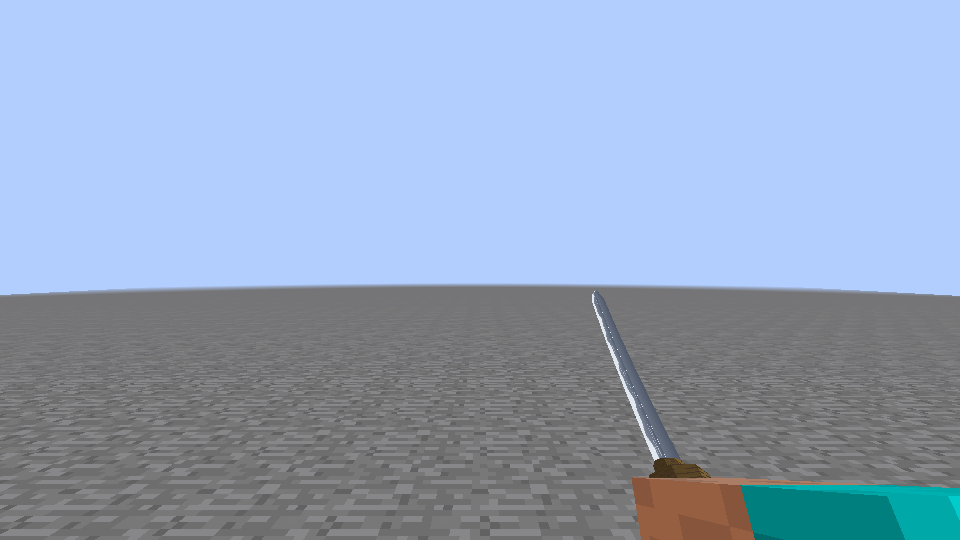
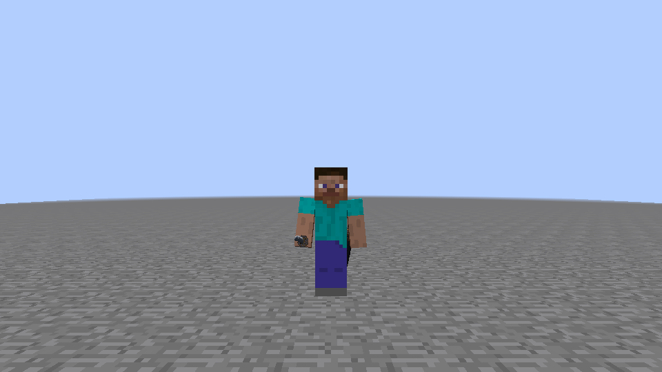
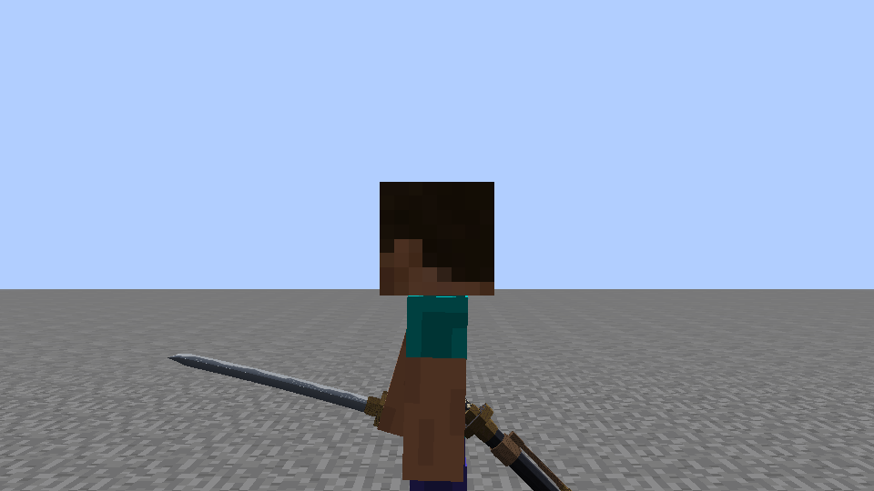
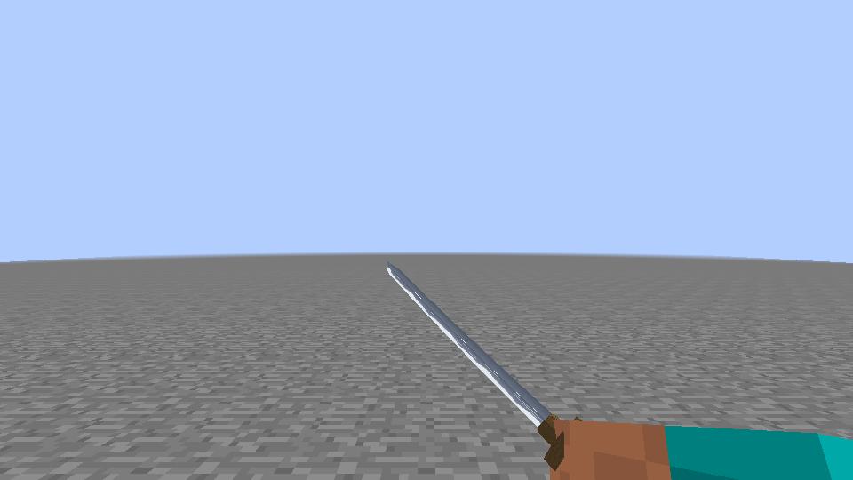

补充 [第三人称挥刀](katana-a-verify/swing-third.png) 为旧拍摄脚本取得的 heavy 采样；它有 HUD，且与第一人称不是同帧，不用于宣称全轨迹刃口一致。[常规侧面](katana-a-verify/art-drawn-side.png) 保留尺度对照。

**建议，尚未实施：**刃口先在 `art/katana/build_models.py` 试 `EDGE_SIGN=-1.0`，再重新实测两个视角；不改本轮生产代码。第三人称若仍不一致，需单独审核模型截面轴向与现有滚转的兼容性。重复柄需要将收刀柄拆为可选资源组/空鞘变体，并由未来经授权的状态选择绘制；只改同一个永久 renderAll 的 sheath.obj，无法兼顾“收刀露柄”和“拔刀空鞘”。

## C. 收刀态、地面与下绪

| 项目 | 结论 | 观察 |
|---|---|---|
| 左髋 45° 鞘体挂点 | **通过（本批采样）** | 侧面鞘斜向后下方，没有水平外伸，鞘体在腿外侧。正面、侧面、背面分别见下图。 |
| 鞘口露柄和刀镡、不穿身体 | **失败** | 柄卷进入左臂体积，正面几乎完全被左臂遮住；侧后近景露出柄头/刀镡，柄卷主体仍被手臂吞没。模型新增 −Y 柄与此前无柄鞘的固定挂点不兼容。 |
| 鞘尾站立离地 | **通过（采样）** | 侧面完整尾金可见，没有被地面截断。 |
| 鞘尾蹲下离地 | **通过（采样）** | 实际 sneak=true、onGround=true，完整尾金仍可见，没有明显穿地。 |
| 鞘尾跑步离地 | **通过（采样）** | 实际 sprint=true、onGround=true，腿有迈步姿态，尾金没有明显穿地；不推广为所有跑步相位均通过。 |
| 下绪位置 | **通过：朝外后侧；细节辨识无法判断** | +Z 经 45° 挂点转换后向后、向上，结/尾在身体后外侧，而非藏在身体内侧。侧后/背面有棕色带可见，正面基本不可见；普通视距不能清楚识别完整绳结与两根尾绳，不宣称细节清晰。 |

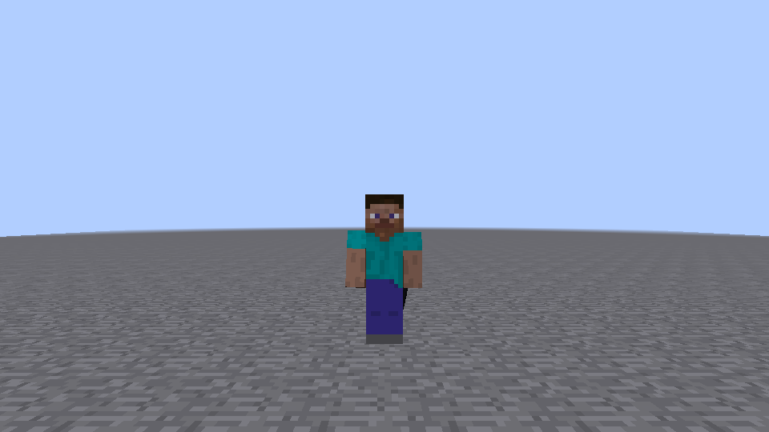
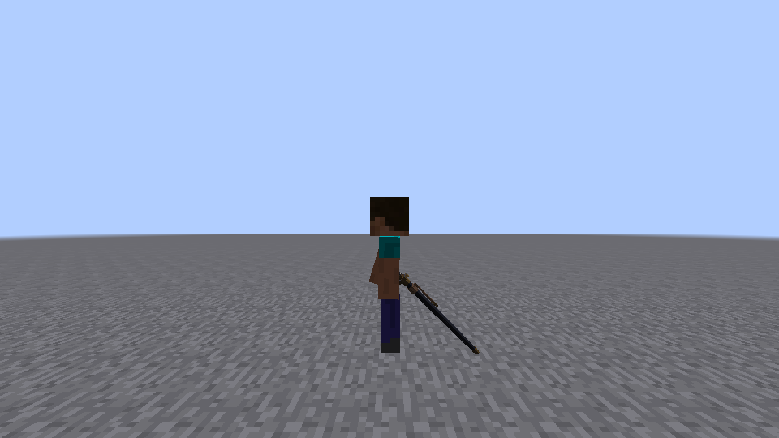
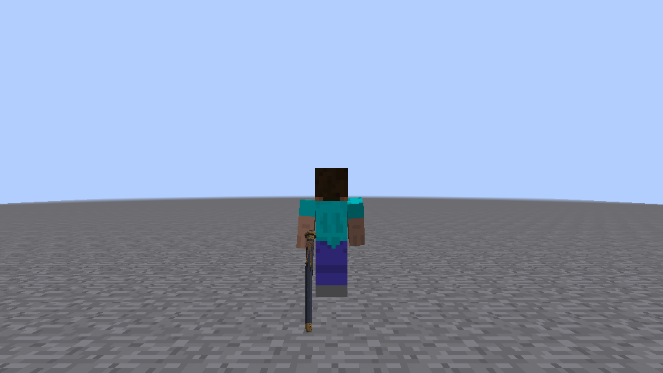
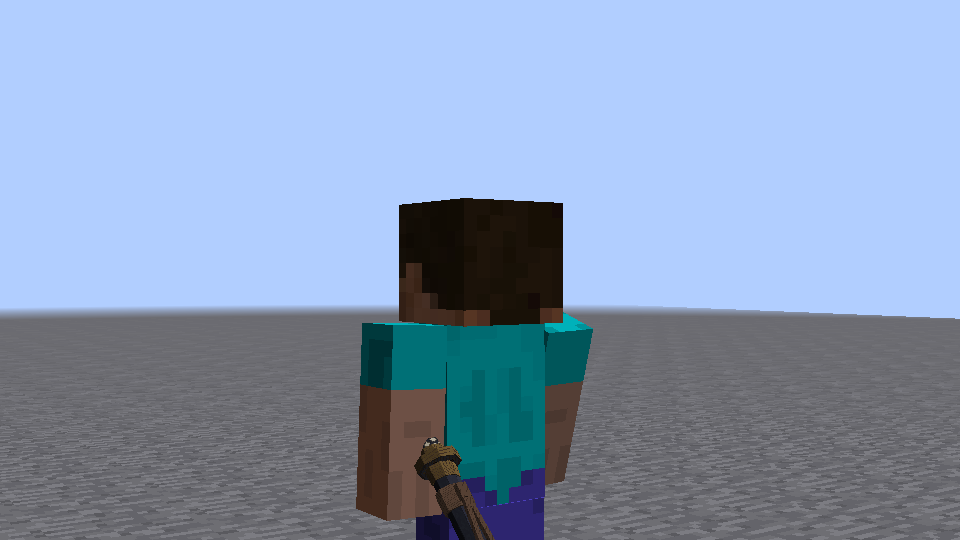
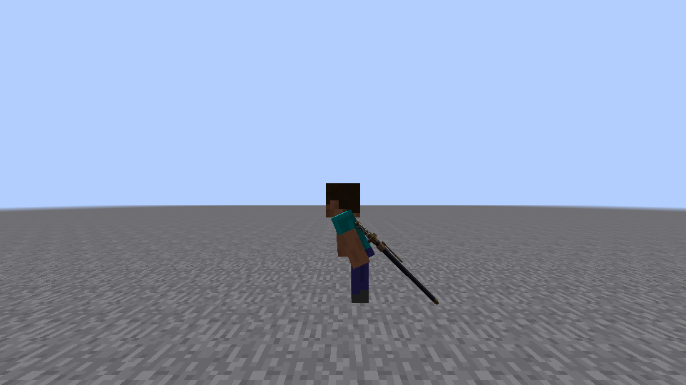
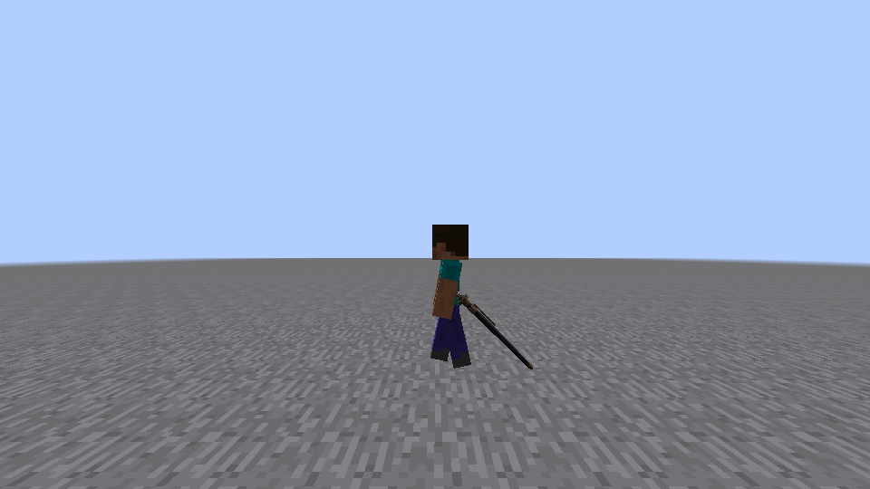

关键姿态日志（detail2）：front tick=110 / sneak=false / sprint=false；crouch tick=172 / sneak=true；run tick=205 / sprint=true。三者 feet=64.0、onGround=true、sheathed=true、action 为空。不是用移动相机冒充蹲下或跑步。

穿臂也可用读取的几何解释：收刀柄卷中心线 y 约 −0.28…−0.08，在固定挂点及既有 1/0.9375 模型尺度下约落于 Biped `(x=0.32, y=0.34…0.49, z=−0.03…0.12)`；静止左臂范围包含这段位置。该估算只解释已观察到的遮挡/交叠，不替代截图，也不表示已找到修复值。

**建议，尚未实施：**未来可单独试 `KatanaRendering` 配置的 sheathX 外移或 sheathZ 后移，再重查柄、腿、鞘尾和所有姿态。本轮不改这些参数。若要求只改模型，可在 `build_models.py` 调整收刀 hilt 的相对位置/长度，但须保持柄与鞘口装配，不宜只把柄随意悬空。若想让下绪更容易从左侧看见，可在该文件将结/尾转到左外侧面（模型 +X）后重新验证；不能直接断言翻到 −Z 就是正确外侧。

## D. 贴图：无法判断完整验收，部分通过

最近邻过滤已实测。第一人称刃纹白色波纹可辨，刀身不是一条无宽度白线；晴天地面/默认光照下刀身、青铜件、深色鞘之间能区分，未见过曝，鞘偏暗。**未观察到已拍表面上的明显开缝、严重拉伸或纹理错位**，但这不证明鞘八个面和刀镡两板面全部正确：部分面朝内，柄卷被手掌/左臂遮挡，板面角度很窄。近景也不足以确认八面接缝和每一个柄卷菱形都清晰，所以不判整项通过。

证据为上述两个近景与第一人称有效帧。若用户希望改善可读性，建议在 `paint_atlas.py` 调整 tsuka 的菱形与底色明暗对比，或在 `build_models.py` 检查八面 UV 分配/刀镡板面 UV；**这不是已确认的 UV 错误，不建议未经验证先改**。本轮贴图、UV 和过滤方式全部保持不变。暗环境、其它皮肤及盔甲未验证。

## E. 双人同屏：通过（补拍），首轮取景失败保留

真实 P0B 客户端观察 P0A；近处背对镜头的是 P0B，左前方远处是 P0A。两种权威同步状态均有对应画面，P0A 收刀时不显示手中刀，拔刀时显示手中刀。

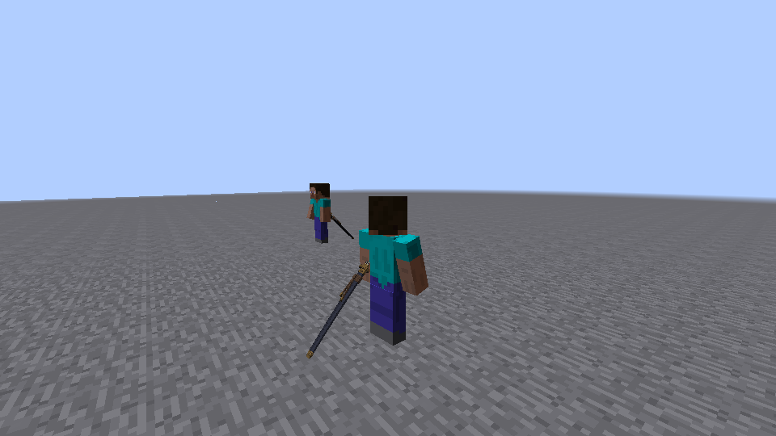
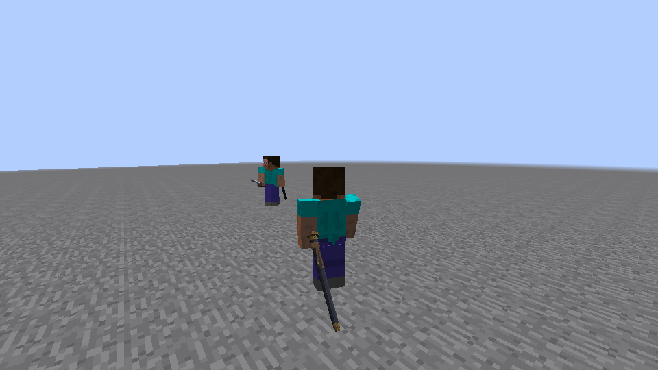

首轮 detail 的观察者截图只有空地，**取景证据失败**，不是模型加载失败；见 [失败原图](katana-a-verify/failed-observer-empty.png)。首次夹具在改 yaw/pitch 后立即截图，未等待原版相机插值稳定，且第一人称不能同时见两个人。detail2 只修验证夹具：稳定十 tick、同步取景的 prev/current 角度，使用观察者第三人称偏看 20°，不改生产相机、网络或挂点。未删除首轮失败，未把空地照片算作通过。

## F. 战斗回归：通过

同一新模型冻结 jar，0 ms 和 FIFO 100 ms RTT 各仅跑一次 `--souls-view`，没有 A/B，也不择优重跑。

| 场景 | 完成 | 失败 / 未完成 | 连击期间 S08 | 包引起视角变化 |
|---|---:|---:|---:|---:|
| art-a-view-0 | 20/20 | 0 / 0 | 0 | 0 |
| art-a-view-100 | 20/20 | 0 / 0 | 0 | 0 |

每档 61 次动作开始，20 条均覆盖 SOULS。0 ms 全日志另有一次初始化未标记传送引起旋转，位于连击之前，不隐去，也不计作连击期间 0；100 ms 全日志该值为 0。此项只证明本批模型替换没有破坏原回放，不证明模型的视觉问题已经解决。

## G. 性能：无法判断模型替换的性能差值

未观察到可明确归因于新模型的持续帧率变化，但**确有采样停顿**：detail1 的 P0A 截图范围累计最大帧间隔 70.04 ms；detail2 为 249.44 ms，P0B 为 156.98 ms。均在 60 FPS 上限、PNG 导出、切取景/近景以及双客户端同机运行条件下测得；没有旧模型在相同场景的性能基线，无法把这些峰值归因或排除为模型成本，不能写“没有性能损失”。面数低不是性能验收依据。不增加旧模型 A/B 或优化生产代码。

## 入库范围与停止

只入库必要的 15 张真实 PNG（含一张失败取景），合计 **609,597 字节，约 0.58 MiB**，以及短汇总。原始进程日志不入库。新增拍摄源集不进入生产 jar，默认不开启；只读过滤查询保存/恢复 GL texture 状态，没有改变采样方式。`git diff -- src/main` 为空，美术生成器也未运行。

失败项均保留，参数与文件建议由用户决定，**本轮不修复**。停止等待审核。
