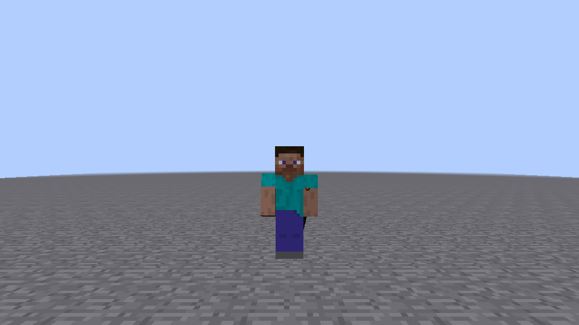
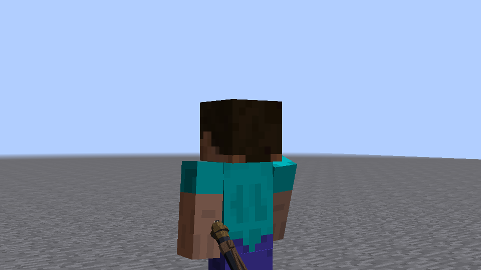
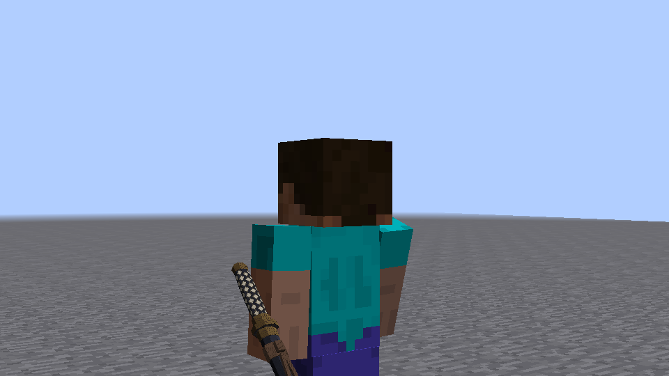
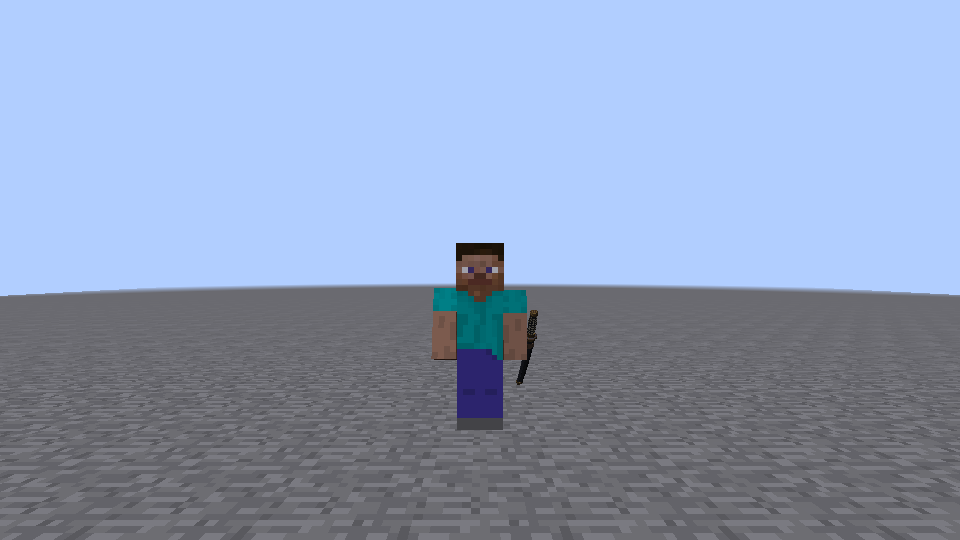
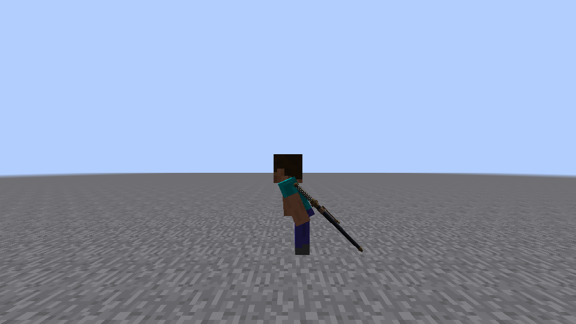
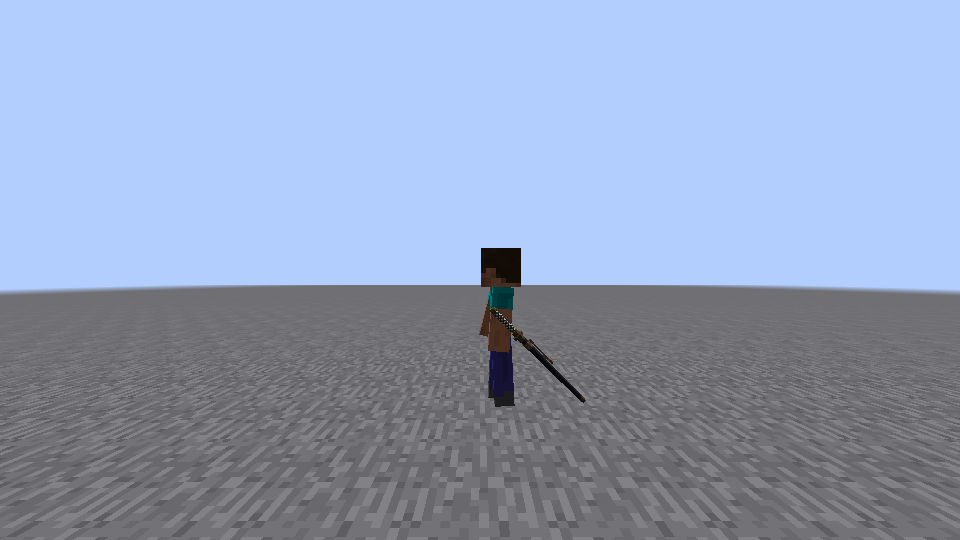
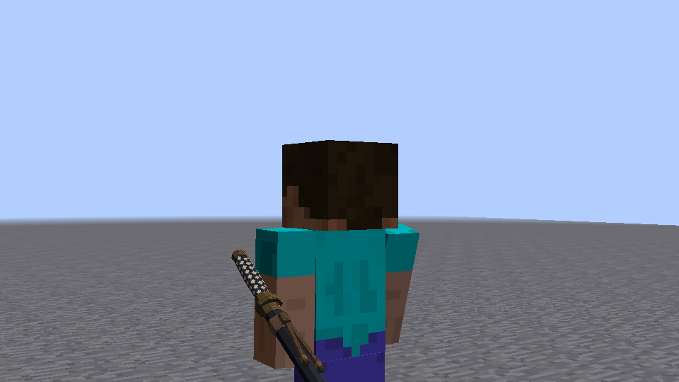

# 收刀鞘挂点配置扫描（新模型 bfeae81）

## 范围与方法

2026-10-11，真实 Windows 专用服务器与 P0A/P0B 两个 Minecraft 1.7.10 客户端，0 ms 直连。独立 worktree 的 `claude/upbeat-goodall-klai2o` 更新至 `bfeae81`。先读 [旧验证 C 节](KATANA-A-VERIFY.md#c-收刀态地面与下绪)及 [新模型约定](katana-a.md)。本轮只覆盖收刀挂点，不重新验收刀刃、拔刀空鞘或战斗。

使用新资源构建的冻结 jar，SHA256 `7f11a85be9b72792e9105a06156aa8c6852faabe37977a039dcddce2bcf4dbcc`。鞘长 1.017，露柄到模型 Y=-0.429；不是旧验证的较短柄。每组新启专服及双客户端，通过已有 `--art-verify` 夹具拍照。只在两个客户端运行目录的 `config/clashweave/render.cfg` 写入 mount 分类；其余配置使用同样的默认值。没有修改源码、夹具、模型、贴图或代码默认值。

构建命令：

```powershell
$env:JAVA_HOME='C:\Program Files\Zulu\zulu-25'
$env:VERSION='0.1.0-dev'
.\gradlew.bat spotlessCheck checkstyleMain checkstyleTest test p0LaunchFiles -I tools/p0/validation.gradle --no-configuration-cache --console=plain
Copy-Item build/libs/clashweave-0.1.0-dev-dev.jar build/p0/mount-bfeae81.jar
```

实测输出：`BUILD SUCCESSFUL in 3s`；JUnit **107 tests / 0 failures / 0 errors**，test 实际执行。冻结后的同一个 jar 用于全部九个会话，不重新生成模型。

运行标签 `mount-bfeae81-default`，然后按 A→H 顺序运行 `mount-bfeae81-A` … `mount-bfeae81-H`，无重跑或丢弃组。命令均为：

```powershell
python tools/p0/dual.py --art-verify --mod-snapshot build/p0/mount-bfeae81.jar --snapshot-coremod --accept-eula --label mount-bfeae81-A
```

启动前配置注入的复现方式见文末。运行后同时读取 P0A/P0B 的实际 render.cfg 核对四个值，摘要见 [summary.json](sheath-mount-sweep/summary.json)。原始日志、完整运行目录、冻结 jar 均留在忽略的 build/p0，不入库。

每组保留 6 张原始游戏 PNG：正面、侧面、背面、鞘口近景、蹲下、跑步。站立侧面兼作站立姿态证据；不是将一张站姿图片冒充三种姿态。近景仅将 FOV 设为 30°，常规图为 70°，配置挂点不变。蹲下和跑步使用真实按键状态；相机转到侧面只为取景。

| 取景/姿态 | 客户端采样 tick | 实际姿态 |
|---|---:|---|
| 正面 | 110 | sneak=false, sprint=false |
| 侧面/站立 | 125 | sneak=false, sprint=false |
| 侧后鞘口近景 | 132 | sneak=false, sprint=false |
| 背面 | 140 | sneak=false, sprint=false |
| 蹲下侧面 | 172 | sneak=true, sprint=false |
| 跑步侧面 | 205 | sneak=false, sprint=true |

全部采样要求 `action=` 为空、`sheathed=true`、`onGround=true`、`feet=64.0`。关键日志逐张留在汇总中，含实际状态。判断依据是未裁剪的真实截图及既有挂点/模型坐标；**没有通过 GPU 深度或网格相交测试量化穿模体积**。表中的“未见”只覆盖这些姿态采样，不代表所有跑步相位、装备、皮肤和动作均不穿模。

## 默认基线：复现穿左臂

默认 `(0.32, 0.55, 0.18, 45°)` 在新模型上仍失败。正面长柄主体被左臂吞没；近景柄卷有一段明显进入左臂，露柄加长没有消除问题。




## 八组结果

“穿臂”包括柄卷/刀镡与左臂的交叠；“穿身体”列单指躯干，不将手臂问题隐藏为“身体未穿”。各行同时查看三视角和三姿态。

| 组 | X / Y / Z / Angle | 柄/刀镡穿左臂 | 穿腿 | 穿躯干 | 鞘尾穿地（站/蹲/跑） | 像腰间挂刀吗 | 结论 |
|---|---|---|---|---|---|---|---|
| A | 0.45 / 0.55 / 0.18 / 45° | **有，明显**；正面柄仍被吞没，近景柄卷截入手臂 | 未见 | 未见 | 未见 / 未见 / 未见 | 鞘口在腰旁，但柄与臂粘连 | 失败：穿臂 |
| B | 0.52 / 0.55 / 0.18 / 45° | **有，较轻**；长柄大部分露出，内缘仍截入左臂 | 未见 | 未见 | 未见 / 未见 / 未见 | 大体像，外移后可辨；穿臂未清除 | 失败：穿臂 |
| C | 0.58 / 0.55 / 0.18 / 45° | **未见**；柄卷及刀镡轮廓完整，未见臂面截断 | 未见 | 未见 | 未见 / 未见 / 未见 | **像左腰外侧挂刀**；有可见外移空隙，非紧贴腰带 | **通过（采样），推荐** |
| D | 0.52 / 0.55 / 0.26 / 45° | **有，较轻**；后移使柄更偏身后，内缘仍相交 | 未见 | 未见 | 未见 / 未见 / 未见 | 腰后外侧，较 B 更偏后；仍穿臂 | 失败：穿臂 |
| E | 0.52 / 0.55 / 0.18 / 55° | **有，较轻**；角度变化没有移开柄的内侧 | 未见 | 未见 | 未见 / 未见 / 未见 | 鞘口在腰旁，鞘更向后伸，贴腰感弱于 45° | 失败：穿臂 |
| F | 0.52 / 0.62 / 0.18 / 45° | **有**；降低后柄下段/内缘仍进入左臂 | 未见 | 未见 | 未见 / 未见 / 未见 | 鞘口更低，尾端更近地面；未解决穿臂 | 失败：穿臂 |
| G（黄金腰线） | 0.52 / 0.40 / 0.18 / 45° | **有，较轻**；抬高后柄靠近肩部，内缘仍相交 | 未见 | 未见 | 未见 / 未见 / 未见 | 偏高，柄更近肩；未比 C 更像腰挂 | 失败：穿臂 |
| H | 0.58 / 0.40 / 0.18 / 55° | **未见**；柄/刀镡轮廓未被臂面截断 | 未见 | 未见 | 未见 / 未见 / 未见 | 偏高、偏后，更像左肋外侧挂着；不如 C 自然 | 通过（采样），不优先推荐 |

G 的“黄金腰线”只是本次指定组名，不表示已经验证某个黄金比例或美感。Y 是 Biped **向下**的坐标，0.62 降低挂点，0.40 抬高挂点。

辅助坐标校核：读取新 OBJ 的 96 个 hilt 顶点，使用既有 `translate(X,Y,Z) × rotateX(Angle) × scale(1/0.9375)` 变换。在**无动画、无膨胀的标准 ModelBiped 静止左臂盒** `x=0.25…0.5, y=0…0.75, z=−0.125…0.125` 内，严格落入的顶点数分别是 default=48、A=47、B=15、C=0、D=12、E=12、F=15、G=15、H=0。左臂盒核对自本地反编译 ModelBiped 的 `addBox(-1,-2,-2,4,12,4)` 和 `setRotationPoint(5,2,0)`（/16）。

这解释了为何只改 Z/Y/角度不足以清除原有 X 下的交叠；**不是实时相交检测，不把“顶点为 0”当作任意动画都不相交的证明**。最终判断仍限于本批原始照片；没有修改模型或在游戏里替换手臂姿态。


## 各组全部取景

| 组 | 正面（站立） | 侧面（站立） | 背面（站立） | 鞘口近景 | 真实蹲下 | 真实跑步 |
|---|---|---|---|---|---|---|
| A | [正面](sheath-mount-sweep/A-front.png) | [侧面/站立](sheath-mount-sweep/A-side.png) | [背面](sheath-mount-sweep/A-back.png) | [近景](sheath-mount-sweep/A-detail.png) | [蹲下](sheath-mount-sweep/A-crouch.png) | [跑步](sheath-mount-sweep/A-run.png) |
| B | [正面](sheath-mount-sweep/B-front.png) | [侧面/站立](sheath-mount-sweep/B-side.png) | [背面](sheath-mount-sweep/B-back.png) | [近景](sheath-mount-sweep/B-detail.png) | [蹲下](sheath-mount-sweep/B-crouch.png) | [跑步](sheath-mount-sweep/B-run.png) |
| C | [正面](sheath-mount-sweep/C-front.png) | [侧面/站立](sheath-mount-sweep/C-side.png) | [背面](sheath-mount-sweep/C-back.png) | [近景](sheath-mount-sweep/C-detail.png) | [蹲下](sheath-mount-sweep/C-crouch.png) | [跑步](sheath-mount-sweep/C-run.png) |
| D | [正面](sheath-mount-sweep/D-front.png) | [侧面/站立](sheath-mount-sweep/D-side.png) | [背面](sheath-mount-sweep/D-back.png) | [近景](sheath-mount-sweep/D-detail.png) | [蹲下](sheath-mount-sweep/D-crouch.png) | [跑步](sheath-mount-sweep/D-run.png) |
| E | [正面](sheath-mount-sweep/E-front.png) | [侧面/站立](sheath-mount-sweep/E-side.png) | [背面](sheath-mount-sweep/E-back.png) | [近景](sheath-mount-sweep/E-detail.png) | [蹲下](sheath-mount-sweep/E-crouch.png) | [跑步](sheath-mount-sweep/E-run.png) |
| F | [正面](sheath-mount-sweep/F-front.png) | [侧面/站立](sheath-mount-sweep/F-side.png) | [背面](sheath-mount-sweep/F-back.png) | [近景](sheath-mount-sweep/F-detail.png) | [蹲下](sheath-mount-sweep/F-crouch.png) | [跑步](sheath-mount-sweep/F-run.png) |
| G | [正面](sheath-mount-sweep/G-front.png) | [侧面/站立](sheath-mount-sweep/G-side.png) | [背面](sheath-mount-sweep/G-back.png) | [近景](sheath-mount-sweep/G-detail.png) | [蹲下](sheath-mount-sweep/G-crouch.png) | [跑步](sheath-mount-sweep/G-run.png) |
| H | [正面](sheath-mount-sweep/H-front.png) | [侧面/站立](sheath-mount-sweep/H-side.png) | [背面](sheath-mount-sweep/H-back.png) | [近景](sheath-mount-sweep/H-detail.png) | [蹲下](sheath-mount-sweep/H-crouch.png) | [跑步](sheath-mount-sweep/H-run.png) |


## 推荐与限制

建议选 **C：sheathX=0.58, sheathY=0.55, sheathZ=0.18, sheathAngle=45**。它只改 X，保留原腰间高度、后偏移和 45° 斜挂；本批长柄及刀镡不再被左臂吞没，三种姿态下鞘尾均仍离地。H 也未见穿臂，但同时抬高并加大斜角，柄更靠肩、鞘更向后伸，腰挂外观不如 C。







不确定之处：C 的外移产生了可见间隙，模型没有腰带连接件，不能宣称严格“贴腰”或已经解决悬挂连接的美术问题。当前使用无盔甲默认玩家和少量运动采样；未验证盔甲外层、全部手臂摆动相位、跳跃、受击和动作过渡。因此推荐是这八组及当前模型下的配置取舍，不是对所有动画的穿模保证。

**没有将 C 写入代码默认值或提交运行 cfg**，等待用户审核后决定。本轮未修改生产源码、模型、贴图、美术生成器或夹具。推送前快进承接远端 `3d1b898`，它仅新增 motion2.py / motion_preview2.py，未改变本批模型、贴图和渲染；本报告仍明确验证冻结的 bfeae81 jar，不宣称验证这些新增动画脚本。本轮仅提交报告、汇总和必要截图；旧 C 节是旧模型的历史验证，原文不覆盖或改写。

九个会话均 `complete=true`、`server_exit=0`；专服客户端/OpenGL 类加载计数均 0。两个客户端每组都出现 `CW_RENDER models loaded`，55° 的 E/H 及 45° 的其余组与实际 cfg 一致。入库 **50 张原始 PNG，共 1,738,350 字节（约 1.66 MiB，低于 3 MB）**，含默认基线 2 张及每组 6 张；不提交无关拔刀照片、逐帧数据或完整日志。


## 启动前写配置的复现方法

`dual.py` 创建运行目录后才启动 Java，没有 mount 参数。本次在忽略的 build/p0 使用以下 Python 包装，仅在 `Popen` 启动客户端之前写 cfg，随后运行**原封不动**的 dual.py；没有替换/执行修改过的源码字符串。将脚本临时保存为 `build/p0/run_mount.py`，例如 `python build/p0/run_mount.py fresh-C 0.58 0.55 0.18 45`。标签必须未存在，避免覆盖历史运行。

```python
import pathlib, runpy, subprocess, sys
root = pathlib.Path(__file__).resolve().parents[2]
label, *values = sys.argv[1:]
assert len(values) == 4
folder = root / 'build/p0/runs' / label
assert not folder.exists()
original = subprocess.Popen

def start(command, *args, **kwargs):
    if isinstance(command, list) and '--username' in command:
        directory = pathlib.Path(kwargs['cwd']).resolve()
        assert directory.parent == folder.resolve()
        cfg = directory / 'config/clashweave/render.cfg'
        cfg.parent.mkdir(parents=True, exist_ok=True)
        keys = ['sheathX', 'sheathY', 'sheathZ', 'sheathAngle']
        cfg.write_text('mount {\n' + ''.join(
            '    S:' + key + '=' + value + '\n'
            for key, value in zip(keys, values)) + '}\n', encoding='utf-8')
    return original(command, *args, **kwargs)

subprocess.Popen = start
sys.argv = ['dual.py', '--art-verify', '--mod-snapshot',
            'build/p0/mount-bfeae81.jar', '--snapshot-coremod',
            '--accept-eula', '--label', label]
try:
    runpy.run_path(str(root / 'tools/p0/dual.py'), run_name='__main__')
finally:
    subprocess.Popen = original
```
