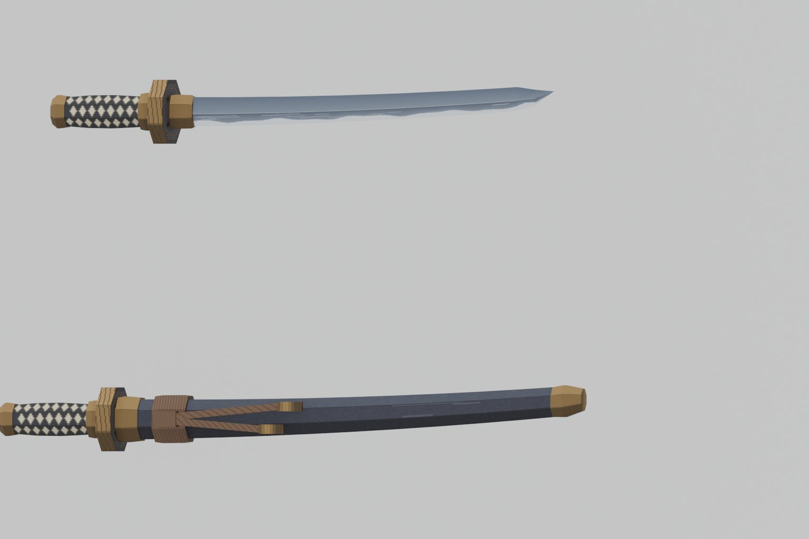
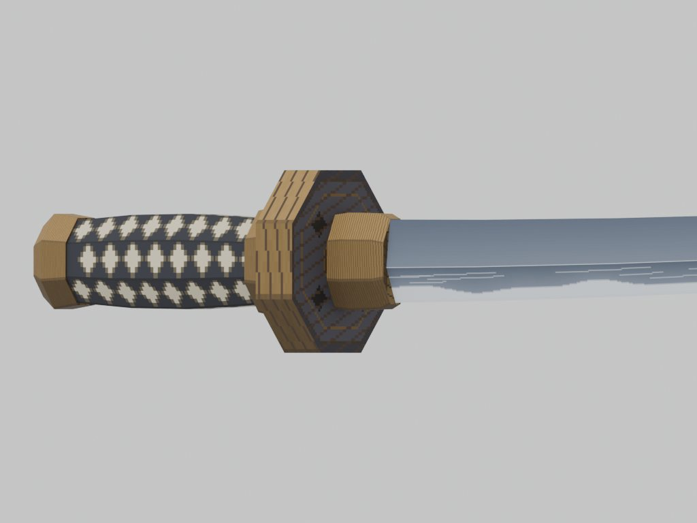
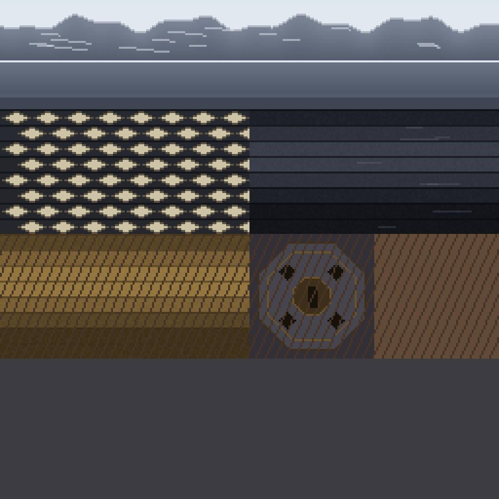

# 日本刀 美术 v1(方向 A:低多边形 + 手绘色块)

> 状态:模型与贴图已生成并接入资源路径,**尚未在游戏内验证**。本文是美术决定与验收清单,不改动 `docs/design/` 的任何规则。

## 决定

- **基础美术语言选 A(低多边形 + 手绘色块)**,由用户决定。理由是工程上的:1.7.10 只有固定管线光照、没有 PBR,A 最接近游戏里实际能呈现的样子;色块清楚,换色板就是新皮肤;同一套语言能延展到后续的"神秘、工业"系刀。
- 概念图 B(写实偏暗)和 C(日系清爽)**不丢弃,作为皮肤方向的参考**:它们只改调色板与少量贴图细节,不重做模型。见 `skin-ref-b-dark.jpg`、`skin-ref-c-clean.jpg`。
- 皮肤始终是表现层:服务端只下发 ID,不决定时序和轨迹,与 `WeaponResolver` / `AppearanceState` 的既有口子一致。

## 模型约定(与 P0 占位模型一致,渲染代码未改)

| 项 | 约定 |
| --- | --- |
| 单位 | 方块(1 格 = 1 米量级) |
| `katana.obj`(拔刀态握在手里) | 握柄中心为原点,刀身沿 +Y;柄尾 `y=-0.18`,刀尖 `y=1.17`,总长 1.35;截面最大 ±0.081 × ±0.074 |
| `sheath.obj`(收刀态挂在左髋) | 鞘口在 `y=0`,鞘尾 `y=1.25`(游戏里 +Y 对应身体向下方向,挂点 45°);**露出鞘口的柄、刀镡、柄头沿 -Y 延伸到 `y=-0.32`** |
| 贴图 | `textures/models/katana.png`,256×256,两个模型共用(`PresentationAssets` 只绑一张) |
| 面数 | 刀 340 三角面,鞘连柄 572 三角面 |
| OBJ 格式 | 全部三角面,`v/vt/vn`,无材质文件;`o` 分组(blade/hilt、saya/hilt) |

占位模型的鞘上没有柄,所以收刀时只能看到一根鞘。新鞘把柄和刀镡做进去,这是为了解决此前"刀鞘位置有点问题"的一部分原因。

## 图集分区(256×256,原点左上)

| 区域 | 像素 | 内容 |
| --- | --- | --- |
| blade | (0,0)–(256,56) | 刀身:上 32 行为刃面(含刃纹),32–48 行棱线面,48–56 行刀背;横向沿刀身长度 |
| tsuka | (0,56)–(128,120) | 柄卷:8 个面各 8 行,菱形露出的鲛皮 |
| saya | (128,56)–(256,120) | 鞘漆:8 个面各 8 行,按光照分块明暗 |
| brass | (0,120)–(128,184) | 青铜件:柄头、缘、刀镡边、鞘口金、鞘尾金、下绪铜头 |
| tsuba | (128,120)–(192,184) | 刀镡板面:深色铁板、青铜内圈、四个开孔 |
| cord | (192,120)–(256,184) | 下绪绳 |
| 剩余 | y>184 | 空,留给皮肤、发光层、扩展 |

调色板在 `art/katana/paint_atlas.py` 的 `PALETTE` 中,**换皮肤只换调色板键值**。

## 重新生成

```bash
# 需要 Blender 5.2(无头)和 Python + Pillow
python3 art/katana/paint_atlas.py out/katana.png
blender -b --python art/katana/build_models.py -- out        # 生成 katana.obj、sheath.obj、两份 .blend
blender -b --python art/katana/render_preview.py -- out out/preview   # 预览图
```

`art/katana/blend/` 里有两份 `.blend`,可以直接在 Blender 里打开修改。

## 预览





预览用 Cycles 渲染,**有高光和柔和阴影,游戏里是固定管线光照,会更平、更暗**,黄铜在游戏里不会这么亮。

## 未验证,以及 Windows 上要核对的项

这些都是预览图无法回答的,必须在游戏里看:

1. **模型能被 Forge 1.7.10 加载。** `o` / `s 0` 行是否被 `WavefrontObject` 忽略;日志里不应有模型解析报错。
2. **刃口方向。** 刃在模型的 +X 侧,刀尖向 -X(刀背侧)弯。如果游戏里刃口朝向反了,改 `build_models.py` 里的 `EDGE_SIGN = -1.0` 重新生成即可,不需要重新建模。
3. **握持位置。** 握柄中心仍是原点,第一人称、第三人称拔刀态都要截图,确认手掌握在柄上(此前 P0 为占位模型调整过"掌内柄适配")。
4. **收刀态的位置。** 柄和刀镡现在从鞘口露出,看 45° 挂点下柄是否穿进身体、鞘尾是否穿地。
5. **下绪(绳)在鞘的哪一面。** 目前在 +Z 面,看它是在鞘的外侧(玩家能看到)还是内侧,必要时改成 -Z 面。
6. **贴图过滤与亮度。** 1.7.10 对这张贴图是最近邻采样,看菱形柄卷和刃纹是否清晰、整体是否过暗。
7. 需要验证时请复用 P0 的 12 张真实截图设置,并额外拍:拔刀态第一人称、第三人称、收刀态左髋特写、鞘尾离地情况。

## 已知限制

- 刀身只有一种形状(单刃、轻微弧度),没有刀纹之外的装饰;其它刀种之后按同一语言另建。
- 物品栏图标(`textures/items/katana.png`)仍是占位,未更新。
- 斩击拖尾、命中特效、UI 标记等 2D 素材未做,计划由 Codex 出图后做透明背景与像素对齐处理。
- 动画和姿势不在本次范围,等 P1 的动作定下来。
