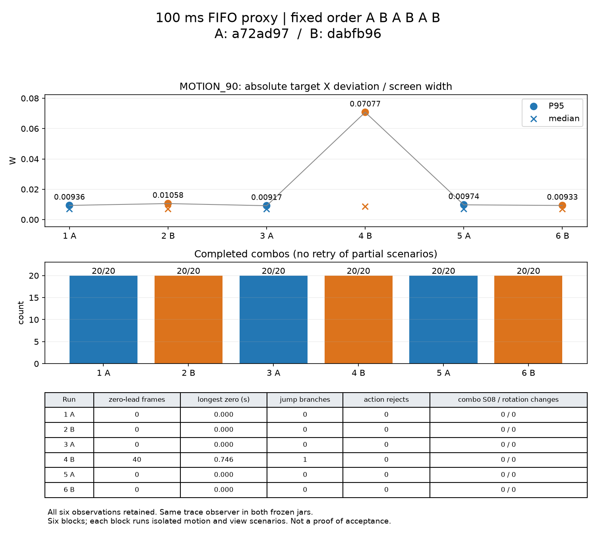

# 100ms 异常的冻结 jar 交替重复测量

## 结论

**无法区分噪声与回归，不宣称通过。** B 的一次 MOTION_90 异常得到复现，但三次重复的均值差没有同时超过两版各自的运行间波动：B−A 平均 P95 差为 0.020799W，超过 A 极差 0.000573W，却小于 B 极差 0.061439W。B 的正常最小值 0.009328W 落在 A 的 0.009168–0.009742W 内。不能把异常判定为纯噪声，也不能用这三次重复证明系统回归。

六次连击回放各完成 20/20，没有系统性的完成数差异；两版均没有任何动作拒绝，`EXPIRED_OR_CHANGED` 各为 0。**本批未复现该拒绝，无法判断上一轮 seq107 是否版本特有，也无法归因于相机 yaw。** 旧失败和停顿压力场景未被本批正常结果覆盖，仍见 [上一轮报告](FEEDFORWARD-STALL.md)。

## 控制变量与口径

只测量，没有修改 `src/main`、`src/test`、配置默认值或生产 jar。A 为已有冻结 `a72ad97`，B 为冻结 `dabfb96`，SHA256：

- A：`ca5ab905aaae97cbe512a39660a012a305a8d29209ce77b8a17ca1d478b5b4c8`
- B：`54293996e7197acd62d4ecc03bcafad141a2721dd83b98b4b9bfcd9ba105f7d9`

同一 Windows 本机、Java8、专服加双客户端、960×540、60fps上限、相同独立夹具。100ms 为既有 FIFO 代理两向各 50ms；不声称实际 RTT 完全无抖动。按 **A(运动→连击)、B(运动→连击)、A、B、A、B** 六个区组连续执行，每个子场景启动新专服/双客户端与独立世界，共十二个子运行，避免运动状态污染连击。没有启动失败、重试、挑选或删除某次结果；两个冻结 jar、验证 jar 和 trace jar 的运行时哈希保存在汇总 JSON。

MOTION_90 沿用 `--camera-suite motion` 的连续目标：45°/s→90°/s→横移阶段转换时不重建目标。本报告只统计90°/s全阶段，含转换，不挑稳定段。P95/中位数为真实 GLU 投影 `abs(targetX−0.5W)` 的最近秩分位数；各运行的分位数再作等权均值，不合并帧池。前馈归零为实际 `lead==0`；最长归零时长按首个至最后一个连续归零帧的墙钟时间，不含下一非零帧间隔。

位置包统计覆盖首条连击开始至最后相机帧，包含可能失败后剩余时间；不只统计完成序列。登录/布景的窗口外 S08 六次分别为 2、3、2、3、3、2，单列在 JSON；不能把整段进程说成 S08=0。拒绝分布统计 P0A 连击期的 LIGHT/HEAVY/SHEATHE；每次61个动作请求，全部开始执行。

## 全部六次与均值/最小/最大

表中拒绝数为动作请求拒绝总数；六次原因分布均为空（所有原因0），不会隐藏 `EXPIRED_OR_CHANGED`。S08和包视角变化均指上述连击期。均值/极值行是每版三次运行的统计。

| 顺序/版本 | 中位偏差 W | P95 W | 归零帧 | 最长归零 s | 完成连击 | 拒绝数 | S08 | 包视角变化次数 |
| --- | ---: | ---: | ---: | ---: | ---: | ---: | ---: | ---: |
| 1 A | 0.006948 | 0.009365 | 0 | 0.000000 | 20/20 | 0 | 0 | 0 |
| 2 B | 0.006973 | 0.010577 | 0 | 0.000000 | 20/20 | 0 | 0 | 0 |
| 3 A | 0.006910 | 0.009168 | 0 | 0.000000 | 20/20 | 0 | 0 | 0 |
| 4 B | 0.008566 | 0.070767 | 40 | 0.745990 | 20/20 | 0 | 0 | 0 |
| 5 A | 0.006979 | 0.009742 | 0 | 0.000000 | 20/20 | 0 | 0 | 0 |
| 6 B | 0.006937 | 0.009328 | 0 | 0.000000 | 20/20 | 0 | 0 | 0 |
| A 均值 | 0.006946 | 0.009425 | 0.000 | 0.000000 | 20 | 0 | 0 | 0 |
| A 最小 | 0.006910 | 0.009168 | 0.000 | 0.000000 | 20 | 0 | 0 | 0 |
| A 最大 | 0.006979 | 0.009742 | 0.000 | 0.000000 | 20 | 0 | 0 | 0 |
| B 均值 | 0.007492 | 0.030224 | 13.333 | 0.248663 | 20 | 0 | 0 | 0 |
| B 最小 | 0.006937 | 0.009328 | 0.000 | 0.000000 | 20 | 0 | 0 | 0 |
| B 最大 | 0.008566 | 0.070767 | 40.000 | 0.745990 | 20 | 0 | 0 | 0 |



## 跳变分支与时间点

独立 `tools/p0-diagnostics` jar 在 `-Dclashweave.trace=true` 下插入只读观察调用，冻结 jar 不改字节；关闭 trace 时 transformer 原样返回输入字节。观察器读取 `lead` 入口字段，按各版已核对公式记录短路优先分支，退出时读取真实速度/抑制时长，不写实体、估计器或调度字段，不提供游戏返回值。`!ready` 对应 `NOT_READY`；历史丢失是 B 的 `!ready && lostHistory` 附注，不是第四个独立 OR 分支。两版加载同一 trace jar，SHA256 `91402c2f27b69d4ea8e28dd0210332063125850b808a00977fa54c1ce52f5436`。

MOTION_90 六次的 `!ready / 位置残差 / 角度跳变 / 历史丢失` 分支计数依次为 `0/0/0/0`、`0/0/0/0`、`0/0/0/0`、**`0/1/0/0`**、`0/0/0/0`、`0/0/0/0`；只有第4区组 B 有一个额外停顿保护。所有阶段的分支数和事件相对时间另存汇总 JSON，未排除初始化：每次运动/连击子场景各一次首次 `!ready`，没有后续历史丢失。

第4区组 B 在 MOTION_90 **10.989149s**：位置残差 **3.405631格 > 配置阈值3格**，角度变化只有1.012695°（阈值30°），真实间隔18.2193ms，既不是角跳变也不是停顿帧。进入既有约0.75s跳变抑制。由相邻 `CW_THIRD_FRAME` 重建的原始样本年龄0.1010582s、上次原始速度39.627191格/s，推测位移4.004653格，而实际样本只更新0.613081格；重建残差与入口 trace 完全一致。夹具此时未换目标、未传送，持续90°/s绕行，故这是**连续运动的位置残差误判**。名义圆周速度约12.566格/s，原始到达样本的速度估计被放大；仅凭本次trace不能进一步区分代理、收包或渲染调度在哪一层制造了样本节奏变化。

**11.213469s**又遇108.6092ms真实渲染间隔，触发B停顿保护，但此时既有抑制尚余0.525680s，大于停顿恢复0.3s，未延长该抑制；初始归零不是新停顿条件造成的。40个归零帧、最长0.745990s均保留，P95=0.070767W 超过原0.05W阈值，不能算该次通过。位置残差公式及约0.75s恢复机制在A中也存在；这一源码事实不等于已证明A在相同收包节奏下的实际表现。

完整连击子场景还记录到：第1区组 **A** 在首条连击开始后7.613394s触发位置残差（14.536119格，方位变化0°、预测速度原本0），连击仍完成；第6区组B在31.207235s发生105.0877ms停顿（原预测速度/方位变化均0），连击仍完成。两版都可能触发保护，不能把“任何位置残差”视为B独有。

## EXPIRED_OR_CHANGED 与相机 yaw

六次各61个动作请求，共366个；`EXPIRED_OR_CHANGED`、输入门拒绝、其他调度拒绝、朝向回落均0。请求从客户端按下到服务端消费，观察到的动作实例ID和交锋修订号均未变化；收包 stamp 年龄总范围1–4tick，消费时有效年龄2–5tick，全部朝向历史匹配 `OK`。每次范围/均值和计数在JSON。

观察器已经能为每个实际拒绝保留客户端真实yaw、按下时stamp/实例/修订号、收到和消费时tick/状态，以及调度时当前实例、缓冲到期tick、边窗口和confirmedHit；本批没有拒绝实例，因此没有可填的逐例归因，`expired_diagnostics` 六次均为空。不能凭零次观测断言“上一轮不是yaw导致”，也不能把旧seq107归为途中变更或戳过期。

源码核对：`EXPIRED_OR_CHANGED` 来自 `tick >= request.expires || current.id != request.origin`，其中expires是**服务端接受请求后的4tick缓冲截止**，不等同于输入门的 `STALE`。判定不读取yaw；yaw可能间接影响边要求的confirmedHit。本批没有该失败，故未验证这种间接因果。夹具在派生失败后 `viewActive` 不复位、未到light_3便不能完成，会使一次失败终止后续计划；这能解释旧运行为什么停在8条，但不能独自解释最初拒绝的原因。本轮只读取，不修夹具。

## 命令、只读校验与限制

实际先启动第1区组运动，随后用 `--after-first-motion` 接着执行剩余11个子场景；该开关只采用已有第一个运行，未重跑替换。首次从头复现可直接运行 `ab_measure.py`，标签已存在则拒绝覆盖。前置构建和实际命令：

```powershell
$env:JAVA_HOME='C:\Program Files\Zulu\zulu-25'
$env:VERSION='0.1.0-dev'
.\gradlew.bat p0LaunchFiles p0DiagnosticsJar test -I tools/p0/validation.gradle --no-configuration-cache --console=plain
python tools/p0/dual.py --label ab-1-A-motion --camera-suite motion --rtt 100 --mod-snapshot build/p0/baseline-a72ad97.jar --snapshot-coremod --diagnostic-trace --accept-eula
python tools/p0/ab_measure.py --after-first-motion
python tools/p0/ab_metrics.py
python tools/p0/plot_ab.py
python tools/p0/diagnostics_check.py
.\gradlew.bat spotlessCheck checkstyleMain checkstyleTest test --rerun -I tools/p0/validation.gradle --no-configuration-cache --console=plain
```

十二次进程均完成、专服客户端/OpenGL类加载均0；连击完成以客户端逐条completed为证，不用进程COMPLETE代替。只读校验对A/B各2000帧（包含不规则dt、200ms停顿、跳变、clear）逐项比对注入前后返回值与全部实例字段，分别20000/22000项比较全部相同；四个被注入类的字段写入指令数量不变，trace关闭字节原样返回。Spotless、Checkstyle main/test通过；**86项JUnit重新实际执行，0失败/0错误/0跳过**，未修改生产测试。

仅提交本报告、可复跑的验证工具、[汇总JSON](evidence/ab-100ms/summary.json)及上面一页图（证据约183KiB）；完整日志、逐帧投影、冻结jar均留在忽略的build目录，未入库。分支 trace 事件只是少量触发点，不是逐帧文件。

限制：每版只有3次，不能可靠估计稀有误判率；trace反射/日志有观测开销，两版相同且函数输出/状态验证一致，但这不证明计时无扰动。两个完整jar的比较不能单独证明某一行代码的因果。原停顿/切换超调仍未解决，本轮没有重复该场景、没有修改算法，也没有新增相机预设。下一步若需定位因果，应审核后将同一异常样本节奏输入两版作受控比较，不能在本报告里擅自修复或宣布验收通过。

完成后停止，等待审核。
