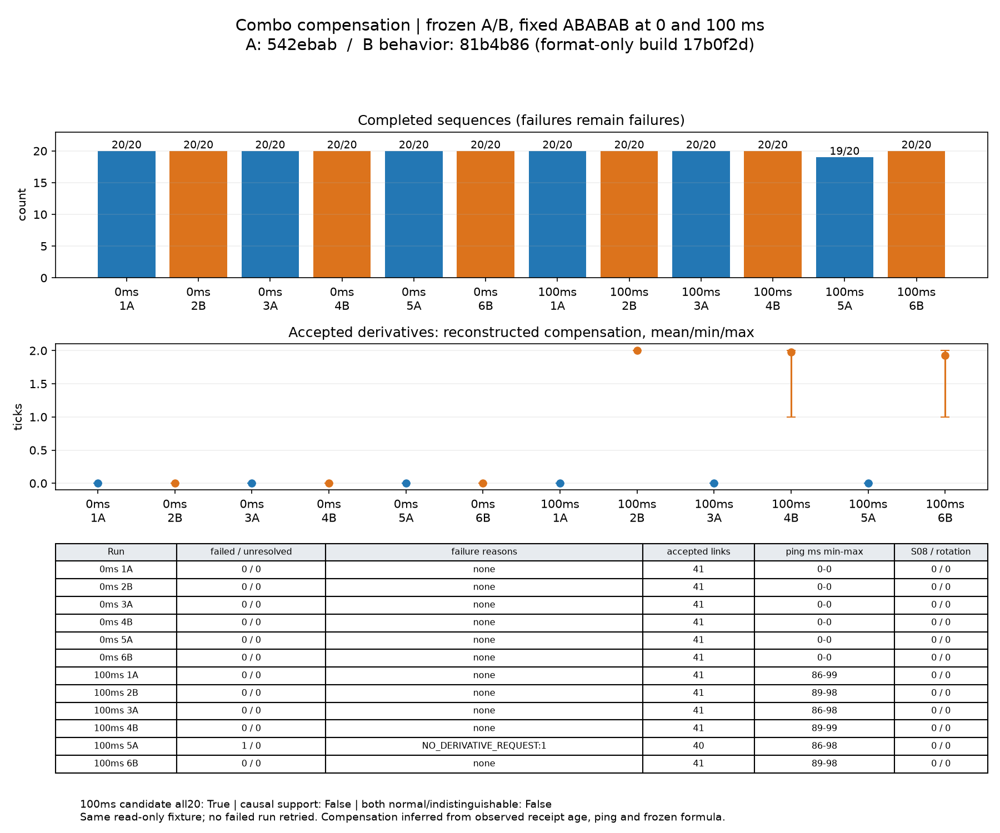

# 连段窗口补偿：Windows双客户端0/100ms交替验证

候选100ms三次均20/20且ILLEGAL_NODE=0：达标；预定因果对照条件：未成立。失败全部保留，未调整参数或重跑。

基线唯一失败是客户端夹具漏发派生，补偿无法挽救尚未发送的请求。两版都未复现ILLEGAL_NODE，因此**本批仍不能证明补偿改善了连段窗口拒绝**，不能把候选60/60与基线59/60的差别归因于补偿。

## 版本、构建与固定判据

A=542ebab（补偿前），B行为=81b4b86（含2ee5076）。候选初次指定构建Spotless失败；经用户“ok”授权，仅应用Spotless格式修正，单独提交17b0f2d，修改LatencyCompensation与Scheduler排版，无逻辑或数值修改。冻结候选构建提交为17b0f2d，**不将修正后的jar散列冒充原始81b4b86 jar**。

夹具容错已先以独立提交0c973ee推送，详见[容错报告](COMBO-REPLAY-RECOVERY.md)。本批共同夹具另加只读ping/config采样，生产源中没有新增观察分支。两版运行同一验证jar，SHA256：`4fb68c51c90efb6142b2b75840d9966add4a89ba3c1ce63a2c31fbce33773a44`。

```powershell
$env:JAVA_HOME='C:\Program Files\Zulu\zulu-25'
$env:VERSION='0.1.0-dev'
.\gradlew.bat spotlessCheck checkstyleMain checkstyleTest test --rerun p0LaunchFiles -I tools/p0/validation.gradle --no-configuration-cache --console=plain
```

两版完整命令通过Spotless、Checkstyle main/test、test、p0LaunchFiles。test实际执行，不是NO-SOURCE或缓存替代：A **90项**、B **107项** JUnit，失败/错误/跳过均0。EntityPlayerMP.ping编译通过，未换字段。Java25构建、Java8运行。

- A `build/p0/baseline-542ebab.jar` SHA256：`b22166219f1acdbbe7d3c216065963a210661dbe4eed6397abf2d46dc381c0ef`。
- B `build/p0/comp-candidate.jar` SHA256：`2042bb08e13c8291aac9abf92d6164fc1c36e030bec6153b354fcc9d71e0fba6`。

预先判据保留：100ms B每次20/20且ILLEGAL_NODE=0满足运行标准；A有ILLEGAL_NODE而B没有才支持因果效果；0ms需保持一致，补偿为0或很小；出现候选失败只记录，不改参数重跑；双方均无失败则“本批无法区分补偿的效果”。

## 运行命令与完整表

```powershell
python tools/p0/comp_measure.py
python tools/p0/comp_metrics.py
python tools/p0/plot_comp.py
```

comp_measure从jump_measure结构直接复制，仅替换jar/标签/manifest，并按要求仅保留souls-view场景、增加0ms档；未使用字符串替换后exec。固定先0ms A/B/A/B/A/B，再100ms A/B/A/B/A/B。十二次均首次运行，各新启专服和两个真实Windows客户端；100ms使用同一个50ms单程FIFO代理。标签comp-0-1-A-view至comp-100-6-B-view，没有覆盖历史目录、重试或择优。每次20条计划，完成与失败分开，原始日志留在忽略的build中。

以下年龄/补偿/ping均统计**被START接受的派生请求**，格式为平均值[最小–最大]。派生包括首次iai→light_1，故正常20条通常共41个派生START。动作拒绝与序列失败分别列出，避免将没发出请求当成服务端拒绝。

| RTT/区组 | 完成/失败/未决 | 失败原因 | 动作拒绝原因 | 接受派生数 | 收包年龄 tick | 补偿 tick | ping ms | EXPIRED | S08/包视角变化 |
| --- | ---: | --- | --- | ---: | ---: | ---: | ---: | ---: | ---: |
| 0ms 1A | 20/0/0 | 无 | 无 | 41 | 0.024 [0–1] | 0.000 [0–0] | 0.000 [0–0] | 0 | 0/0 |
| 0ms 2B | 20/0/0 | 无 | 无 | 41 | 0.000 [0–0] | 0.000 [0–0] | 0.000 [0–0] | 0 | 0/0 |
| 0ms 3A | 20/0/0 | 无 | 无 | 41 | 0.000 [0–0] | 0.000 [0–0] | 0.000 [0–0] | 0 | 0/0 |
| 0ms 4B | 20/0/0 | 无 | 无 | 41 | 0.000 [0–0] | 0.000 [0–0] | 0.000 [0–0] | 0 | 0/0 |
| 0ms 5A | 20/0/0 | 无 | 无 | 41 | 0.000 [0–0] | 0.000 [0–0] | 0.000 [0–0] | 0 | 0/0 |
| 0ms 6B | 20/0/0 | 无 | 无 | 41 | 0.024 [0–1] | 0.000 [0–0] | 0.000 [0–0] | 0 | 0/0 |
| 100ms 1A | 20/0/0 | 无 | 无 | 41 | 2.000 [2–2] | 0.000 [0–0] | 96.537 [86–99] | 0 | 0/0 |
| 100ms 2B | 20/0/0 | 无 | 无 | 41 | 2.024 [2–3] | 2.000 [2–2] | 96.561 [89–98] | 0 | 0/0 |
| 100ms 3A | 20/0/0 | 无 | 无 | 41 | 2.000 [2–2] | 0.000 [0–0] | 96.268 [86–98] | 0 | 0/0 |
| 100ms 4B | 20/0/0 | 无 | 无 | 41 | 2.073 [1–3] | 1.976 [1–2] | 96.659 [89–99] | 0 | 0/0 |
| 100ms 5A | 19/1/0 | NO_DERIVATIVE_REQUEST:1 | 无 | 40 | 2.000 [2–2] | 0.000 [0–0] | 96.000 [86–98] | 0 | 0/0 |
| 100ms 6B | 20/0/0 | 无 | 无 | 41 | 2.098 [1–5] | 1.927 [1–2] | 96.463 [89–98] | 0 | 0/0 |
| 0ms A 均值 | 20/0/0 | 见逐次行 | 见逐次行 | 41 | — | — | — | — | 0/0 |
| 0ms A 最小 | 20/0/0 | 见逐次行 | 见逐次行 | 41 | — | — | — | — | 0/0 |
| 0ms A 最大 | 20/0/0 | 见逐次行 | 见逐次行 | 41 | — | — | — | — | 0/0 |
| 0ms B 均值 | 20/0/0 | 见逐次行 | 见逐次行 | 41 | — | — | — | — | 0/0 |
| 0ms B 最小 | 20/0/0 | 见逐次行 | 见逐次行 | 41 | — | — | — | — | 0/0 |
| 0ms B 最大 | 20/0/0 | 见逐次行 | 见逐次行 | 41 | — | — | — | — | 0/0 |
| 100ms A 均值 | 19.6667/0.333333/0 | 见逐次行 | 见逐次行 | 40.6667 | — | — | — | — | 0/0 |
| 100ms A 最小 | 19/0/0 | 见逐次行 | 见逐次行 | 40 | — | — | — | — | 0/0 |
| 100ms A 最大 | 20/1/0 | 见逐次行 | 见逐次行 | 41 | — | — | — | — | 0/0 |
| 100ms B 均值 | 20/0/0 | 见逐次行 | 见逐次行 | 41 | — | — | — | — | 0/0 |
| 100ms B 最小 | 20/0/0 | 见逐次行 | 见逐次行 | 41 | — | — | — | — | 0/0 |
| 100ms B 最大 | 20/0/0 | 见逐次行 | 见逐次行 | 41 | — | — | — | — | 0/0 |

每条序列状态及每个已接受派生的stamp、收包年龄、处理tick、origin、ping、重建补偿、动作年龄详见[汇总JSON](evidence/combo-compensation/summary.json)，不保存逐帧数组。全部实际连击期S08与包导致的yaw/pitch变化可在逐次行核对；统计窗口是第一条开始至最后一条终态，含失败序列，不只筛成功段。初始登录/布置场景的传送不进入连击期指标。



## 补偿量与ping的观测依据

现有CW INPUT提供stamp、effectiveStamp、receivedTick、consumedTick，但**没有直接输出Request.compensation或ping**。实验源集ComboLatencySample在END/HIGHEST、生产END/NORMAL消费前读取实际player.ping、公开当前动作及只读配置（基线无补偿字段时记0）；每个请求必须匹配同一consumedTick采样，缺采样会报错。未改ping，未写调度状态，未插入生产条件分支或修改Netty管线。

JSON的compensation_ticks_reconstructed是依据冻结生产公式重建，**不是直接采样瞬态Request字段**：

```text
age = max(0, receivedTick - effectiveStamp)
ping<=0 / cap<=0 / age<=0 => compensation=0
否则 compensation=min(age, configCap, ceil(ping/100)+jitterTicks)
```

Scheduler随后再以该limit夹receiptAge；正常正值输入得到同一结果。基线重建值为0。重建器两项纯测试通过，覆盖未知ping、基线、年龄/配置/RTT共同限幅；夹具汇总合成测试1项通过。没有将计算出的补偿冒充新增生产日志中的实测字段。

## 失败、恢复与结论限制

本批没有被拒绝的动作请求，没有ILLEGAL_NODE或EXPIRED_OR_CHANGED实例可列；不能据此断言之前的失败已解决。

comp-100-5-A-view第15条失败原因NO_DERIVATIVE_REQUEST，已开始实例[44, 45]；其后仍开始[16, 17, 18, 19, 20]。失败不计完成，没有用下一条成功覆盖它。

失败与继续开始下一条的结果逐序列保留在JSON；失败不计完成，未开始或无终态的条目不计成功。

第15条的两个实例分别是light_1（tick1066开始）和light_2（tick1074开始）；之后没有light_3请求。第16–20条均实际完成，证明漏发后的恢复。ILLEGAL_NODE/WINDOW_CLOSED拒绝后的恢复路径本批未自然触发，保留该实测限制。

0ms两版完成数、拒绝、失败、位置包与补偿量按表对照；精确请求时刻不要求逐条相同。候选100ms没有ILLEGAL_NODE时，不存在可用于归因“补偿上限太小/初次ping为0”的拒绝样本；不凭猜测扩大参数。本批不测试更高RTT、长期低TPS或刻意卡顿，也不替代旧失败记录。

十二次专服进程正常结束、客户端/OpenGL类加载为0，运行snapshot散列逐次保留。证据仅汇总JSON、一页图；没有逐帧文件、完整日志或额外截图入库。完成后停止，等待审核。
