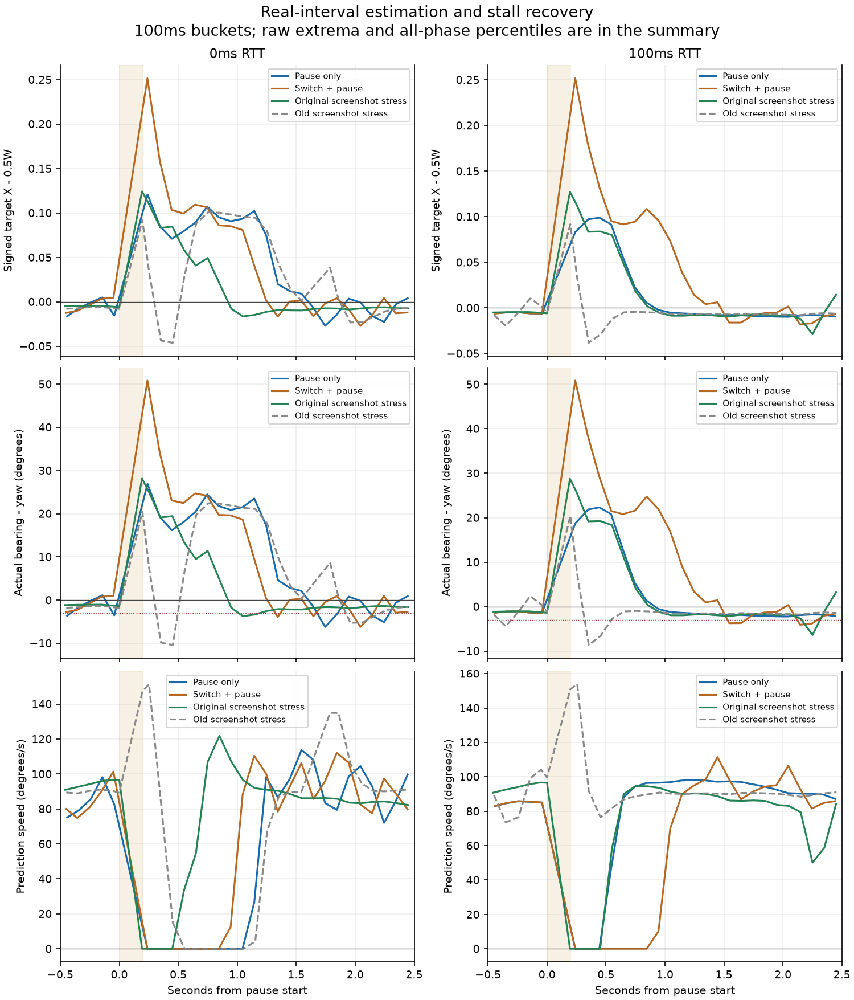

# 前馈墙钟与停顿保护

## 结论与范围

在审核 `d4ae846` 上追加。**代码修复与纯逻辑验证完成，但真实客户端验收未全部通过，不能宣称停顿问题已解决。** 最终版 0ms 的 PAUSE_ONLY / SWITCH_PAUSE 最大反向领先为 7.339° / 7.280°，100ms 为 2.420° / 5.435°；其中三项超过 3°。连续运动、原截图压力和位置包回归的完整数据列在下文，不以一次较好的运行覆盖失败。

生产修改仅限 `CameraBearing`、`LockCamera` 的参数传递、`CombatConfig` 的两个新增配置及测试。求解器、硬边界、碰撞、预设、滤波/阻尼参数、战斗、网络和协议未改。新增实验开关和统计脚本只在 `tools/p0`；实验代码不进入生产 jar。第一人称不调用此估计器，本轮未重跑第一人称真人体验。

## 原因、实现与实际取值

原 `change / dt` 的角度变化跨越真实渲染间隔，但 `dt` 已截断至 50ms，停顿后的比值会被放大。本次使用传入的未截断 `seconds`，非有限/负值按 0 处理；分母下限 1µs，零积分间隔不更新速度。角度跳变阈值也改成 `max(30°, maxSpeed × realSeconds × 2)`。位置样本年龄仍用真实墙钟；速度低通、位置滤波和临界阻尼的积分仍受 50ms 上限约束。

| 配置（camera） | 实测使用值 | 可配置范围 | 含义 |
| --- | --- | --- | --- |
| cameraFeedForwardStallSeconds | 0.1s | 0.05–1s | 严格超过该真实帧间隔，当前帧速度置零且不更新 |
| cameraFeedForwardStallRecovery | 0.3s | 0–2s | 停顿帧结束后按墙钟计时抑制前馈；期间原阻尼继续追踪 |

上述值按用户指定的经验起点使用，未通过调低前馈上限或关闭前馈来改善统计。预测速度上限仍 180°/s、最大预测角仍 45°、`lockStrongSmoothTime=0.15s`、位置低通 `tau=0.1s`、镜头转速上限仍 720°/s。恢复只丢弃预测，不添加角度冲量。

单纯修正除数时，纯回放中的目标切换会让保留的滤波位置追赶新目标，估计速度达到 164.958°/s，超过真实 90°/s 的 1.1 倍。故 `CameraBearing.clear()` 记录已有历史的丢失，下一次采样沿用原有跳变保护时长 `3 × (smooth + filterTau)`，本配置为 0.75s；不重置调用者的滤波位置或相机阻尼。首次无历史采样只丢弃当前预测，不附加该恢复时长。这是估计器内部的保护，不改变阻尼参数或转速上限。

## 纯逻辑、构建与过程记录

**86 项 JUnit 实际运行，0失败 / 0错误 / 0跳过**；原77项保留。新增8项估计器测试、1项配置覆盖测试；已有停顿测试改为验证归零、墙钟恢复和原位置样本年龄语义。包括真实间隔/跳变阈值、零与非有限间隔、0.1s边界、0.3s恢复、首次采样与切换区别、±180°环绕以及四种回放。

90°/s 理想圆周，真实位置经既有 `Filter`，相机经既有 `Spring`；每10ms取样，第500帧注入200ms停顿、30°目标切换或两者。断言速度≤99°/s，停顿后误差不低于原稳态偏置−1°，不是把稳态偏置改成0来判断。

| 纯回放 | 最大预测速度 °/s | 最小实际方位−yaw ° | 事件前稳态偏置 ° |
| --- | --- | --- | --- |
| 匀速 | 90.000121 | -0.965454 | -0.965440 |
| 停顿 | 90.064214 | -0.965454 | -0.965440 |
| 切换 | 90.000121 | -0.965454 | -0.965440 |
| 切换+停顿 | 90.000121 | -0.965454 | -0.965440 |

Spotless、Checkstyle main/test、`build` 均通过。这只证明上述纯逻辑和构建，不取代下列运行验收。

首个实现错误地对首次目标也抑制0.75s，0/100ms 45°/s连续绕行P95分别为0.028234W / 0.041290W，明显劣于旧版0.004433W / 0.004401W。因此区分首次采样与历史丢失后，以新的 `stall-verified-*` 标签完整重跑；首版六次的汇总保留在JSON的 `first_implementation`，未覆盖。首版0ms停顿曾测得2.354° / 2.195°，最终版0ms不达标也照实保留，不能择优宣称通过。

最终版第一次启动标签 `stall-final-pause-0` 在首客户端登录前发生 `EXCEPTION_ACCESS_VIOLATION / OpenAL64.dll+0x11066`，专服未完成、游戏样本0。失败摘要保留；其后新标签重启同一版代码，不把原生启动崩溃当作游戏验收样本。全部完整运行的runtime SHA、进程退出/完成/专服类加载计数在汇总JSON。

## 实际停顿与运动测量

沿用 `--camera-diagnosis`：真实僵尸8格以90°/s绕行，每阶段12秒，约第4秒只暂停渲染200ms、切换到方位相差30°的新实体或两者同时。0/100ms各一次最终版；100ms为FIFO代理两向各50ms，保留本机真实抖动。GLU投影实际渲染位置；正误差是镜头落后，负误差是镜头反向领先。

验收的最大反向领先取**暂停/事件结束到阶段结束的全部有效帧**；图表只压缩展示事件前0.5s到后2.5s，不能用图表窗口排除稍晚的峰值。连续运动P95取整个阶段，含开始和转换，不只取稳定段。

| RTT ms | 场景 | 观测停顿 ms | 停顿/事件后帧数 | 最大反向领先 ° | 最大预测速度 °/s | ≤3° |
| --- | --- | --- | --- | --- | --- | --- |
| 0 | PAUSE_ONLY | 199.770 | 466 | 7.338696 | 118.927 | 失败 |
| 0 | SWITCH_ONLY | 0.000 | 483 | 7.789758 | 130.366 | 参考项 |
| 0 | SWITCH_PAUSE | 199.801 | 475 | 7.279887 | 117.872 | 失败 |
| 100 | PAUSE_ONLY | 200.120 | 469 | 2.419832 | 99.117 | 通过 |
| 100 | SWITCH_ONLY | 0.000 | 480 | 5.118324 | 105.301 | 参考项 |
| 100 | SWITCH_PAUSE | 200.616 | 472 | 5.435453 | 117.318 | 失败 |

连续矩阵保持同一目标，45°/s、90°/s绕行各12秒，再由正常WASD横移。与审核 `a72ad97` 的 `bounds-motion-isolated-0/100` 比较；“不劣化”按原数值严格比较，不事后增加容差。主机帧/收包抖动使小差异不能直接归因于代码，但差值仍完整报告。

| RTT ms | 场景 | 中位偏差 W | P95 W | a72ad97 P95 W | 差值 W | ≤0.05W | 严格不劣化 |
| --- | --- | --- | --- | --- | --- | --- | --- |
| 0 | MOTION_45 | 0.003302 | 0.004469 | 0.004433 | +0.000035 | 通过 | 失败 |
| 0 | MOTION_90 | 0.006934 | 0.010592 | 0.009291 | +0.001300 | 通过 | 失败 |
| 0 | MOTION_STRAFE | 0.019468 | 0.020342 | 0.019231 | +0.001111 | 通过 | 失败 |
| 100 | MOTION_45 | 0.003250 | 0.010048 | 0.004401 | +0.005647 | 通过 | 失败 |
| 100 | MOTION_90 | 0.007797 | 0.063070 | 0.011580 | +0.051490 | 失败 | 失败 |
| 100 | MOTION_STRAFE | 0.017766 | 0.018685 | 0.019469 | -0.000785 | 通过 | 通过 |

100ms、90°/s连续阶段的现有trace共714帧，最大相邻间隔58.356ms，**没有超过100ms的渲染间隔**；前馈为零46帧，最长连续归零0.749129s。因此该阶段的偏差不能归因于新停顿检测触发；日志未标记保护分支，不能单凭约0.75s的长度断言是哪一个跳变/历史条件。汇总JSON附 `prediction_audit`，不补造分支日志。

原压力复跑由 `--motion-stress` 在实验源集中恢复各阶段换目标/玩家位置重置，并于客户端第100tick同步保存PNG；使用真实截图造成的停顿，不人为强制其耗时等于200ms。停止保存PNG的连续矩阵另列，不能拿它替代原压力场景。停顿曲线原点为第4–6秒内最大相邻投影帧间隔；只能称观测间隔，不能推断全部时间都在截图编码内部。原版参照的90°/s P95为0.097627W / 0.086596W。

| RTT ms | 原压力场景 | 中位偏差 W | 新P95 W | 旧P95 W | ≤0.05W |
| --- | --- | --- | --- | --- | --- |
| 0 | MOTION_45 | 0.003334 | 0.019290 | 0.008029 | 通过 |
| 0 | MOTION_90 | 0.007479 | 0.093162 | 0.097627 | 失败 |
| 0 | MOTION_STRAFE | 0.017942 | 0.018839 | 0.024000 | 通过 |
| 100 | MOTION_45 | 0.003327 | 0.019602 | 0.015187 | 通过 |
| 100 | MOTION_90 | 0.007779 | 0.093633 | 0.086596 | 失败 |
| 100 | MOTION_STRAFE | 0.017454 | 0.018250 | 0.020814 | 通过 |

附加位置包回归计划各20条连击；0ms完成20条，100ms只完成8条，**100ms整套20条回归未完成，不能算通过**。统计在连击时间窗内，布置场景用的窗口外行政传送单列，不混作战斗纠正。

| RTT ms | 完成连击 | SOULS覆盖连击 | 动作开始数 | 连击内S08 | 最大开始yaw变化 ° | 最大开始pitch变化 ° |
| --- | --- | --- | --- | --- | --- | --- |
| 0 | 20 | 20 | 61 | 0 | 0.004758075 | 1.5150027 |
| 100 | 8 | 8 | 26 | 0 | 0.15338716 | 2.2027721 |

两档已完成序列内S08均为0；整个回放的包引起yaw/pitch变化也为0。上表动作开始的差值是客户端tick间的原始旋转差，包含正常STRONG跟随，**不是包引起变化**；不把这些非零值改写成0。

100ms第9条未到light_3：输入门/朝向历史匹配通过，但seq107的动作请求返回 `EXPIRED_OR_CHANGED`，夹具的viewActive未复位；专服达到通用1800tick终止条件输出 `P0_NETWORK COMPLETE` 后退出。因此进程摘要complete=true只表示场景进程结束，不能证明20条连击完成。请求条件为何变更未进一步定位，不在本轮修改调度/输入或重跑择优；JSON另列 `complete_20_sequences=false`、started_sequences=9及实际8条。原先20条完整回归的保证未被这次充分重新验证。



图线是每100ms桶均值，极值和P95来自本地所有原始有效帧。JSON仅汇总、桶计数/均值/极值、runtime哈希与测试摘要；不提交逐帧文件、完整进程日志、截图压力产生的PNG或实验jar。

## 复现命令与输出

```powershell
$env:JAVA_HOME = "C:\Program Files\Zulu\zulu-25"
$env:VERSION = "0.1.0-dev"
.\gradlew.bat spotlessApply spotlessCheck checkstyleMain checkstyleTest build -I tools/p0/validation.gradle p0LaunchFiles --no-configuration-cache --console=plain
# BUILD SUCCESSFUL; tests=86 failures=0 errors=0 skipped=0
$probePython = "C:\Users\layue13\AppData\Local\Programs\Python\Python312\python.exe"
foreach ($delay in @(0,100)) {
    & $probePython tools/p0/dual.py --label "stall-verified-pause-$delay" --camera-diagnosis --rtt $delay --accept-eula
    & $probePython tools/p0/pause_metrics.py --label "stall-verified-pause-$delay"
    & $probePython tools/p0/dual.py --label "stall-verified-motion-$delay" --camera-suite motion --rtt $delay --accept-eula
    & $probePython tools/p0/camera_bounds_metrics.py --label "stall-verified-motion-$delay"
    & $probePython tools/p0/dual.py --label "stall-verified-stress-$delay" --camera-suite motion --motion-stress --rtt $delay --accept-eula
    & $probePython tools/p0/camera_bounds_metrics.py --label "stall-verified-stress-$delay"
    & $probePython tools/p0/pause_metrics.py --label "stall-verified-stress-$delay" --original-pressure
    & $probePython tools/p0/dual.py --label "stall-verified-view-$delay" --souls-view --rtt $delay --accept-eula
    & $probePython tools/p0/playfix_metrics.py --label "stall-verified-view-$delay"
}
# 重现时换新label，已有目录会拒绝覆盖。实际按场景依次跑0/100ms，未并行占用25580端口。
& $probePython tools/p0/stall_fix_metrics.py --prefix stall-verified --attempt-summary build/p0/stall-first-attempt.json --output docs/p0/evidence/feedforward-stall/summary.json
& $probePython tools/p0/plot_stall_fix.py --summary docs/p0/evidence/feedforward-stall/summary.json --output docs/p0/evidence/feedforward-stall/stall-curves.png
```

首版汇总可由同一统计脚本 `--prefix stall-fix` 生成；`--attempt-summary` 是可选过程保留参数。运行目录已有即报错，图表依赖使用既有ignored `build/p0/plot-python`，不新增生产/Gradle依赖。

## 未解决与设计影响

真实间隔修复消除了除数截断带来的放大，却没有使真实网络/渲染场景普遍满足反向领先≤3°。既有滤波位置的变化仍混合目标真实运动、客户端实体插值、收包批次和相机相对玩家运动；此次测试能证明余下超调存在，**尚不能仅凭这些日志证明每次峰值的唯一原因**。理想匀速单元测试不能推广成真实链路速度总≤99°/s。

0.3s前馈恢复保护期间仅靠阻尼追赶，存在暂时的落后；目标切换时沿用跳变保护也会增加追赶期。若持续出现大于0.1s的渲染间隔，预测会持续受抑制，这是保护的代价，低帧率长期体验未另测。没有更改求解器/碰撞来隐藏横向误差，也没有调低180°/s上限、缩短阻尼或关闭前馈凑数。

本报告替代旧“停顿只诊断”在修复状态上的结论；旧证据仍保留。模块的一般“跟随不突然甩镜头”要求与本轮明确的3°/0.05W指标尚有差距，不能把数值阈值改成已测值来宣布通过。后续若要区分滤波追赶与真实目标速度，应先定义包批次/瞬移/切换的估计规则再做独立对照；**本轮不擅自采用**。停止等待用户审核。
