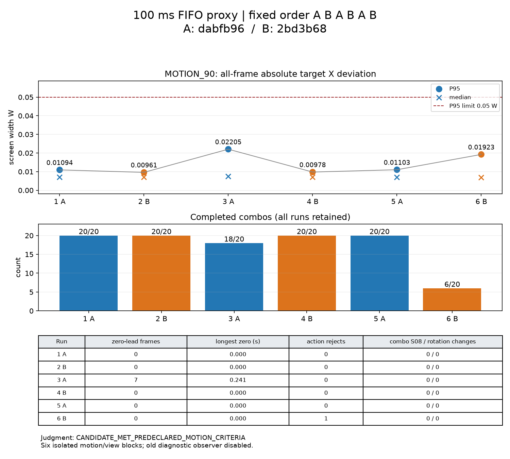

# 位置残差修复：Windows 双客户端交替测量

候选 `2bd3b68` 三次 MOTION_90 的 P95 均 ≤0.05W、前馈归零帧均为0，**满足预先规定的运动判据**；但整套回归未通过：基线一次连击18/20，候选一次6/20。没有重试或择优覆盖。仅测量，未修改生产代码、配置或测试源码。

这批不能证明每一种位置残差误判已消失：基线的7帧归零伴随166.592ms真实帧间隔，可能是已有停顿保护，未加载旧分支观察器，不能将其唯一归因于位置残差。候选本批没有新增归零；两版并非全部正常，因此不满足“双方全部正常则本批无法区分”的特殊判据。P95均值差0.001797W小于各自运行极差，不作为性能优越性证明。

## 构建与控制变量

同一 Windows 主机；A=`dabfb96`，B=`2bd3b68`；固定 A/B/A/B/A/B，每区组先运动再连击。十二个子场景各新启专服、P0A/P0B两客户端和100ms RTT FIFO代理。所有进程正常结束，专服客户端/OpenGL类加载均0；进程COMPLETE不替代连击完成数。标签为 `jump-1-A-motion` / `jump-1-A-view` 至 `jump-6-B-motion` / `jump-6-B-view`，启动前不存在，全部首次运行。

分别 checkout 两版本，设置并运行：

```powershell
$env:JAVA_HOME='C:\Program Files\Zulu\zulu-25'
$env:VERSION='0.1.0-dev'
.\gradlew.bat spotlessCheck checkstyleMain checkstyleTest test --rerun p0LaunchFiles -I tools/p0/validation.gradle --no-configuration-cache --console=plain
```

`--rerun`强制JUnit实际执行。两版 Spotless、Checkstyle main/test、test、p0LaunchFiles 均通过；A实际86项、B实际90项，失败/错误/跳过均0。运行Java8。冻结 `build/libs/clashweave-0.1.0-dev-dev.jar` 为 `build/p0/baseline-dabfb96.jar` 与 `build/p0/jump-candidate.jar`，SHA256分别为：

- A：`54293996e7197acd62d4ecc03bcafad141a2721dd83b98b4b9bfcd9ba105f7d9`
- B：`b22166219f1acdbbe7d3c216065963a210661dbe4eed6397abf2d46dc381c0ef`

共同验证jar SHA256：`8fcbbed513e35c6d97aa56a83a819217fb6bee14fb88bb196d8bdc6cf5827d91`，十二次一致。`jump_measure.py`从`ab_measure.py`直接复制，只改jar名、标签前缀、manifest名并删除`--diagnostic-trace`；没有字符串替换后exec，没有加载旧 `p0-diagnostics.jar`。保留生产trace以读已有观测值，不添加任何生产分支输出。

```powershell
python tools/p0/jump_measure.py
python tools/p0/jump_metrics.py
python tools/p0/plot_jump.py
```

每次具体命令、冻结jar与运行snapshot散列、起止时刻均在[汇总JSON](evidence/jump-windows/summary.json)。原始日志与逐帧数据只留在忽略的build目录，不入库。

## 六次全部数据

MOTION_90取全阶段GLU投影，包括转换，绝对偏差为`abs(targetX−0.5W)`，nearest-rank P95；没有剔除开头或停顿。归零时长是连续归零首末帧的墙钟差。S08统计从首条连击开始至末次相机帧，包含未完成序列与其等待时间；登录/布置场景的传送不算连击期。

| 区组/版本 | 中位偏差 W | P95 W | 归零帧 | 最长归零 s | 完成连击 | 动作拒绝分布 | EXPIRED_OR_CHANGED | 连击S08 | 包视角变化 |
| --- | ---: | ---: | ---: | ---: | ---: | --- | ---: | ---: | ---: |
| 1 A | 0.006977 | 0.010940 | 0 | 0 | 20/20 | 无 | 0 | 0 | 0 |
| 2 B | 0.006980 | 0.009612 | 0 | 0 | 20/20 | 无 | 0 | 0 | 0 |
| 3 A | 0.007407 | 0.022045 | 7 | 0.240702 | 18/20 | 无 | 0 | 0 | 0 |
| 4 B | 0.007002 | 0.009777 | 0 | 0 | 20/20 | 无 | 0 | 0 | 0 |
| 5 A | 0.006930 | 0.011031 | 0 | 0 | 20/20 | 无 | 0 | 0 | 0 |
| 6 B | 0.006819 | 0.019234 | 0 | 0 | 6/20 | ILLEGAL_NODE:1 | 0 | 0 | 0 |
| A 均值 | 0.007104 | 0.014672 | 2.333333 | 0.080234 | 19.333333/20 | 总计0 | 0 | 0 | 0 |
| A 最小 | 0.006930 | 0.010940 | 0 | 0 | 18/20 | 0/次 | 0 | 0 | 0 |
| A 最大 | 0.007407 | 0.022045 | 7 | 0.240702 | 20/20 | 0/次 | 0 | 0 | 0 |
| B 均值 | 0.006934 | 0.012875 | 0 | 0 | 15.333333/20 | 0.333333/次 | 0 | 0 | 0 |
| B 最小 | 0.006819 | 0.009612 | 0 | 0 | 6/20 | 0/次 | 0 | 0 | 0 |
| B 最大 | 0.007002 | 0.019234 | 0 | 0 | 20/20 | 1/次 | 0 | 0 | 0 |

六次包导致的yaw/pitch最大变化均0。B没有≥10帧归零的运行。A的P95极差0.011105W，B为0.009622W；各三次不足以断言系统差异。连击均值差由各一组未完成造成，不能凭此将B失败归因于相机修复。



## 未完成序列与拒绝核对

**区组3/A，第19条：** 仅观察到一次动作START（实例56）。初始请求seq155、stamp1270、origin0、receivedTick1271、consumedTick1272，gate=OK，ACK=START。之后没有下一条LIGHT派生请求，完成数停在18，第20条未开始。不是服务端拒绝；夹具只在狭窄elapsed窗口发派生，并在到达light_3后才复位，本次没有走到复位条件。未记录当时逐tick elapsed，不能证明具体漏窗原因，不推断与yaw有关。

**区组6/B，第7条：** 前两次动作已START，light_2实例21开始于tick902。第三次请求seq79、stamp906、origin21、客户端最近已收到修订3、receivedTick912、consumedTick913（收包年龄6tick），yaw=−0.21142532°、pitch=2.9959307°；gate=OK，朝向历史匹配reason=OK、accepted=true。ACK=ILLEGAL_NODE。调度时动作年龄11tick，不满足light_2→light_3的`age < until=10`，因此没有合法边；不是EXPIRED_OR_CHANGED，也不是朝向回落。该失败后夹具不复位，完成数停在6，第8–20条未开始。修订号取客户端请求前最近同步值，InputMessage本身不携带修订号；请求与日志按FIFO配对并核对数量一致。

六次EXPIRED_OR_CHANGED均0，没有该拒绝的stamp/实例/修订记录可列；不意味着历史失败已被解决。上述诊断字段及归零事件摘要保留在JSON，不提交逐帧文件或完整日志。

## 判定与限制

按提前约定，B三次运动P95及归零均满足判据；本批未观察到位置残差修复后前馈误归零。基线唯一归零事件存在明显停顿混杂，**不能声称这批已唯一证明位置残差分支修复的因果效果**，也不将正常停顿保护当作误判。

**连击必须每次20/20的要求未满足，整套验收不通过。** 视角保护在实际运行的连击期保持S08=0、包视角变化=0，不替代缺失的序列。没有调参数、修改生产代码或重跑失败场景；既有停顿压力失败与相机限制仍保留。结束并等待审核。
