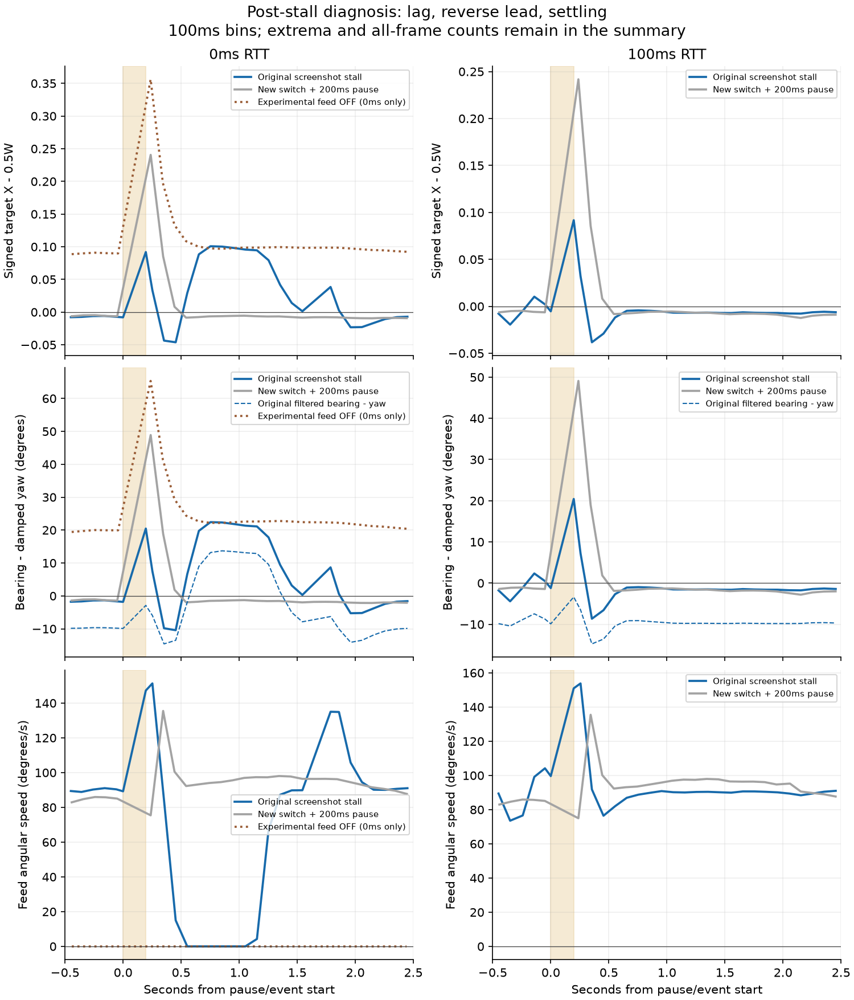

# 近距低矮目标获取与停顿误差诊断

## 结论与范围

任务A复现成立并已修复：四种真实怪物×四档距离的320次获取请求，修复前220/320成功、修复后320/320；另一真实客户端玩家的80次对照均80/80。所有请求经与中键相同的ClientProxy.send(LOCK,-1)→InputMessage→服务端输入门→acquireLock→权威ACK，不用直接写锁定字段来证明获取成功。

任务B只诊断相机停顿后的误差，不改生产相机。结论及一页曲线见后文；没有修改求解器、硬边界、碰撞、预设、特效、动作、防御、格挡延后、交锋、预算、朝向历史匹配、LockAssist、攻击方向或协议。**洞穴蜘蛛1.5格遮挡已被用户接受为已知限制，本轮不处理，也不再把它列为等待修复的缺陷。**

本轮优先采用用户新决定：将获取用的三维锥拆成水平/垂直。docs/design/proposals/prototype-spec-v1.md §9.2 的“前方锥形约30°”现在只对应水平准入；若仍按三维30°解释，会与本轮决定冲突。建议后续规范明确双角及垂直距离安全上限，模块的“原稿细节保留”未删改。

## A：复现与修复后的同矩阵

Java8专服+两个真实Forge1.7.10客户端，0ms本地连接，平地、玩家pitch=0、yaw=0。每组20次获取，成功后另发LOCK解除再进行下一次；解除不计入20次获取。目标清除AI并固定在对应位置，以隔离姿态/推挤；第二客户端实际EntityPlayerMP，不使用假玩家或缩放实体。

角度取与各次实际收包相匹配的服务端几何，20次角度样本完整，所有玩家yaw/pitch均0、目标可见。原服ACK只记录REJECT:LOCK，没有细分拒绝码；下表“三维锥”原因由实际输入门OK、可见性、唯一候选几何和源码的30°门对照归因，**不是声称原服发出了该原因枚举**。汇总JSON保留此来源说明。

| 真实实体/水平距离 | 水平角° | 原眼点垂直角° | 原三维角° | 新中心垂直角° | 修复前成功 | 前拒绝原因 | 修复后成功 |
| --- | --- | --- | --- | --- | --- | --- | --- |
| CHICKEN_R1.0 | 0.000 | 45.707 | 45.707 | 51.783 | 0/20 (0%) | 三维锥>30°，20次 | 20/20 (100%) |
| CHICKEN_R1.5 | 0.000 | 34.346 | 34.346 | 40.253 | 0/20 (0%) | 三维锥>30°，20次 | 20/20 (100%) |
| CHICKEN_R2.5 | 0.000 | 22.294 | 22.294 | 26.931 | 20/20 (100%) | 无 | 20/20 (100%) |
| CHICKEN_R4.0 | 0.000 | 14.373 | 14.373 | 17.615 | 20/20 (100%) | 无 | 20/20 (100%) |
| SPIDER_R1.0 | 0.000 | 40.530 | 40.530 | 49.479 | 0/20 (0%) | 三维锥>30°，20次 | 20/20 (100%) |
| SPIDER_R1.5 | 0.000 | 29.683 | 29.683 | 37.954 | 20/20 (100%) | 无 | 20/20 (100%) |
| SPIDER_R2.5 | 0.000 | 18.881 | 18.881 | 25.080 | 20/20 (100%) | 无 | 20/20 (100%) |
| SPIDER_R4.0 | 0.000 | 12.065 | 12.065 | 16.304 | 20/20 (100%) | 无 | 20/20 (100%) |
| CAVE_SPIDER_R1.0 | 0.000 | 50.077 | 50.077 | 53.873 | 0/20 (0%) | 三维锥>30°，20次 | 20/20 (100%) |
| CAVE_SPIDER_R1.5 | 0.000 | 38.543 | 38.543 | 42.406 | 0/20 (0%) | 三维锥>30°，20次 | 20/20 (100%) |
| CAVE_SPIDER_R2.5 | 0.000 | 25.548 | 25.548 | 28.723 | 20/20 (100%) | 无 | 20/20 (100%) |
| CAVE_SPIDER_R4.0 | 0.000 | 16.634 | 16.634 | 18.906 | 20/20 (100%) | 无 | 20/20 (100%) |
| ZOMBIE_R1.0 | 0.000 | 5.143 | 5.143 | 35.754 | 20/20 (100%) | 无 | 20/20 (100%) |
| ZOMBIE_R1.5 | 0.000 | 3.434 | 3.434 | 25.641 | 20/20 (100%) | 无 | 20/20 (100%) |
| ZOMBIE_R2.5 | 0.000 | 2.062 | 2.062 | 16.066 | 20/20 (100%) | 无 | 20/20 (100%) |
| ZOMBIE_R4.0 | 0.000 | 1.289 | 1.289 | 10.204 | 20/20 (100%) | 无 | 20/20 (100%) |
| PLAYER_R1.0 | 0.000 | 0.000 | 0.000 | 35.754 | 20/20 (100%) | 无 | 20/20 (100%) |
| PLAYER_R1.5 | 0.000 | 0.000 | 0.000 | 25.641 | 20/20 (100%) | 无 | 20/20 (100%) |
| PLAYER_R2.5 | 0.000 | 0.000 | 0.000 | 16.066 | 20/20 (100%) | 无 | 20/20 (100%) |
| PLAYER_R4.0 | 0.000 | 0.000 | 0.000 | 10.204 | 20/20 (100%) | 无 | 20/20 (100%) |

实际玩家眼高1.62格；鸡高0.7、眼高0.595；蜘蛛高0.9、眼高0.765；洞穴蜘蛛高0.5、眼高0.425；僵尸高1.8、眼高1.53；玩家高1.8、眼高1.62。用户估算指出了正确风险，但鸡1.5格实际眼点夹角为34.346°，不是按0.5格眼点估算的约36°。五组失败都符合原30°三维锥拒绝，其余没有输入门拒绝或错误目标。

实际新默认：lockConeHalfAngle=30°（水平）、lockConeVerticalHalfAngle=60°（垂直）；获取16格、保持20格不变。垂直角取玩家眼点到目标包围盒中心，相对服务器已知的当前pitch；绝对中心高度差>lockAcquireRange/2（默认8格）立即拒绝，不能用向上/下瞄准绕过。可见性、友好保护、死亡排除、再次LOCK解除、距离点计算均沿用原逻辑。

评分：`距离/获取范围 + 水平角/水平半角 + 0.01*(垂直角/垂直半角)`；垂直先作为准入条件，评分最多贡献0.01，远小于水平项，沿用稳定实体ID同分裁决。60°和1%次要权重是本轮经验起点/实现取舍，不声称来自魂类游戏，也不保证密集目标下所有排序与旧三维评分完全一致。

## A：大目标与安全回归

僵尸及另一玩家四档距离，各组旧/新均20/20。原20项专服锁定断言（4/8/12/16/20/22获取、锥边缘、遮挡、村民/已驯服宠物/同队保护、16/20保持与22解除）全部仍成立；另加三项真实世界断言，总计23/23：

| 场景 | 旧公式计算/原选择 | 修复后实际选择 |
| --- | --- | --- |
| 僵尸4格、水平0°；玩家8格、15° | 僵尸旧分更低 | 僵尸 |
| 玩家8格、0°；僵尸4格、15° | 玩家旧分更低 | 玩家 |
| 可见僵尸位于上方、水平2格；调整pitch正对中心；三维位置距离<16格、中心垂直差约9格 | 新增安全场景，旧策略没有该垂直距离上限 | 拒绝 |

上/下8格边界、8.000001格越界，以及正对头顶仍不能绕过的行为另由纯JUnit覆盖。水平30°与垂直60°包含边界、越界拒绝；±180°环绕、非有限值、中心高度与配置覆盖均测试。

## B：停顿曲线与归因

**诊断结论：原大偏差包含前馈过冲，不是单调的阻尼追赶。** 正误差定义为目标实际方位−阻尼yaw（镜头落后），负误差为镜头超过目标；屏幕X−0.5W也保留符号。原0ms在停顿后先落后20.66°，反向领先13.47°，随后再次落后22.55°；100ms先落后20.63°，反向领先9.89°后收敛。反向幅度远大于停顿前约−1.5°/−1.35°的已有轻微稳态偏置，不能把它解释成只在追赶。

旧真实压力场景是在每阶段换目标后约第5秒同步保存截图，**并不是切换与停顿严格同一帧**。对其全部逐帧本地日志，取第4–6秒内最大的相邻投影帧间隔作为停顿窗口；没有日志能证明截图函数内部精确睡眠时间，故报告“观测帧间隔”195/197ms。每帧配对投影X、阻尼yaw、实际方位和CW_THIRD_FRAME前馈角；旧日志的角速度按实际配置lead/(0.15+0.1)推回，新控制夹具则直接读取CameraBearing.velocity。原始完整逐帧数据只在ignored build目录。

| 原压力RTT | 观测间隔 ms | 窗口有效帧 | 首个停顿后误差° | 最大落后° | 最大反向领先° | 有效过零次数 | 前馈角速度峰值°/s | 屏幕最大绝对偏差W |
| --- | --- | --- | --- | --- | --- | --- | --- | --- |
| 0 | 195.221 | 160 | 20.656 | 22.549 | 13.466 | 3 | 162.776 | 0.101432 |
| 100 | 197.044 | 170 | 20.629 | 20.629 | 9.889 | 1 | 164.846 | 0.092648 |

为分开变量，额外用**审核a72ad97冻结jar**重新运行：真实僵尸8格、90°/s绕行；只停顿200ms、只切换到前方相差30°的新目标、切换与200ms停顿同时发生。每阶段12秒，在第4秒触发事件；从停顿/事件前0.5秒到后2.5秒的**全部有效渲染帧**记录X偏差、速度、实际及滤波目标方位与阻尼yaw差。不是挑选一条有过冲的曲线。0/100ms各一次；另有0ms临时将前馈maxSpeed=0的同场景因果对照，不保存配置、不改变生产默认，也不是本轮修复。

| RTT ms | 场景 | 实际停顿 ms | 首个停顿/事件后误差° | 最小误差° | 最大前馈°/s | 过零次数 |
| --- | --- | --- | --- | --- | --- | --- |
| 0 | PAUSE_ONLY | 200.690 | 13.093 | -5.453 | 152.295 | 1 |
| 0 | SWITCH_ONLY | 0.000 | -1.306 | -3.587 | 155.789 | 2 |
| 0 | SWITCH_PAUSE | 200.210 | 55.184 | -2.223 | 153.622 | 1 |
| 100 | PAUSE_ONLY | 200.659 | 12.370 | -5.419 | 151.179 | 1 |
| 100 | SWITCH_ONLY | 0.000 | -1.257 | -5.686 | 155.811 | 4 |
| 100 | SWITCH_PAUSE | 199.855 | 55.261 | -2.899 | 153.778 | 1 |
| 0/前馈OFF | PAUSE_ONLY | 199.930 | 35.969 | 20.037 | 0.000 | 0 |
| 0/前馈OFF | SWITCH_ONLY | 0.000 | 19.834 | 16.304 | 0.000 | 0 |
| 0/前馈OFF | SWITCH_PAUSE | 199.846 | 72.905 | 20.328 | 0.000 | 0 |

只停顿已经出现约−5.45°/−5.42°的反向误差；关闭前馈的三个0ms控制都保持正误差、没有过零。它们仍有约20°的匀速稳态落后，**关闭前馈不是已接受修复方案**。新“同时切换+停顿”主要先追赶55°，负误差最低−2.22°/−2.90°，接近随后约−2°的稳态偏置；它没有重现旧场景−13°的完整幅度。不能宣称所有200ms停顿都会产生同样的大过冲。旧0ms二次回摆最明显，新控制只用于定位机制。

触发链（源码与曲线对照）：停顿中目标继续以90°/s移动；恢复帧的积分dt被限制到50ms。已有滤波位置在追赶更远的真实位置，前馈的`change/dt`仍用这个受限dt，把“恢复后的滤波追赶”混入目标角速度。观察到前馈峰值约153–165°/s，明显高于真实90°/s，虽未突破180°/s上限，仍产生过大的预测角。旧两档预测目标相对实际目标的最大超前约26.90°/27.32°，之后阻尼yaw越过真实目标。旧0ms在约0.44秒起又有约0.75秒前馈归零，造成再次落后；已有日志没有显式分支原因，不能断言是位置残差或角跳变哪个保护条件触发。由“正→负→正”和临时无前馈对照，可排除“只是单调追赶”的解释。



图线是100ms时间桶的平均值，每桶保留样本数、均值与最小/最大；时间位置用实际桶内时间均值，停顿间没有伪造插值样本。统计表的极值、过零次数用原始全部帧计算，过零忽略|误差|≤0.5°的噪声；曲线只是压缩显示，不拿桶平均峰值冒充原始峰值。JSON仅汇总与时间桶，无逐帧数组。新控制的SWITCH_ONLY初始状态尚在旧目标上，首帧可能为原负稳态、随后才看到新目标；过零次数不能直接当成机械振荡次数。

本轮**未修改任何前馈、dt、滤波或阻尼代码**。需要用户审核后再决定如何区分真实目标角速度与停顿恢复的追赶速度；此处不擅自应用方案。


## 构建、命令和证据范围

**77项JUnit实际运行，0失败、0错误**，包含原72项以及5项新增获取角度/安全/配置测试。Spotless、Checkstyle、build均通过；主验收专服客户端/OpenGL类加载0。新增测试接入原Gradle测试任务，没有NO-SOURCE。

```powershell
$env:JAVA_HOME = "C:\Program Files\Zulu\zulu-25"
$env:VERSION = "0.1.0-dev"
.\gradlew.bat spotlessApply spotlessCheck checkstyleMain checkstyleTest build -I tools/p0/validation.gradle p0LaunchFiles --no-configuration-cache --console=plain
# BUILD SUCCESSFUL; tests=77 failures=0 errors=0
$probePython = "C:\Users\layue13\AppData\Local\Programs\Python\Python312\python.exe"
& $probePython tools/p0/dual.py --label low-lock-before-isolated --low-lock --accept-eula
# 修复前在a72ad97代码上运行；当前复现需先构建并传入a72ad97的--mod-snapshot build/p0/baseline-a72ad97.jar --snapshot-coremod，使用新label
& $probePython tools/p0/low_lock_metrics.py --label low-lock-before-isolated --policy baseline
& $probePython tools/p0/dual.py --label low-lock-after --low-lock --accept-eula
& $probePython tools/p0/low_lock_metrics.py --label low-lock-after --policy split
& $probePython tools/p0/dual.py --label low-lock-regression-retry --lock-test --accept-eula
# 上述接受场景server_exit=0; complete=true; client_class_loads=0
& $probePython tools/p0/dual.py --label pause-diagnosis-0 --camera-diagnosis --mod-snapshot build/p0/baseline-a72ad97.jar --snapshot-coremod --accept-eula
& $probePython tools/p0/dual.py --label pause-diagnosis-100 --camera-diagnosis --rtt 100 --mod-snapshot build/p0/baseline-a72ad97.jar --snapshot-coremod --accept-eula
& $probePython tools/p0/dual.py --label pause-diagnosis-no-feed --camera-diagnosis --diagnosis-no-feed --mod-snapshot build/p0/baseline-a72ad97.jar --snapshot-coremod --accept-eula
& $probePython tools/p0/pause_metrics.py --label pause-diagnosis-0
& $probePython tools/p0/pause_metrics.py --label bounds-motion-clock-0 --original-pressure
# 100ms同理。画图可在ignored目录安装依赖，不改变项目Gradle依赖：
& $probePython -m pip install --target build/p0/plot-python --only-binary=:all: matplotlib
& $probePython tools/p0/plot_pause_diagnosis.py --summary docs/p0/evidence/lock-acquisition-diagnosis/pause-curves-summary.json --output build/p0/pause-diagnosis.png
```

旧jar是开始改生产代码之前从已审核a72ad97冻结的dev jar，不入库；每次运行冻结SHA见JSON。初次低矮锁定夹具漏隔离原CompositionScenario，导致另一目标/锁字段被原夹具改变，已停止该次并排除数据，保留attempt-summary。一次JUnit配置测试构造器写错导致编译失败，改为实际load(File)后全量通过。第一次锁定回归客户端在启动阶段USER32.dll原生崩溃，没有游戏样本；新label重跑23断言全真，旧失败不覆盖。

相机四个核心类（LockCamera、SoulsCamera、CameraBearing、SoulsComposition）的当前编译字节码与冻结a72ad97逐项一致，见scope-summary.json。证据共约0.66MiB，仅入库汇总JSON和一页图表。逐帧诊断日志、完整进程日志、实验jar、绘图库都在ignored build/p0；不提交逐帧文件、过程PR.md/TODO.md。未重新修改或全面重测相机构图；相机共存、真人锁定体验、任意密集目标排序和不同高度地形仍待后续审核。任务B不修，完成后停止等待用户审核。
