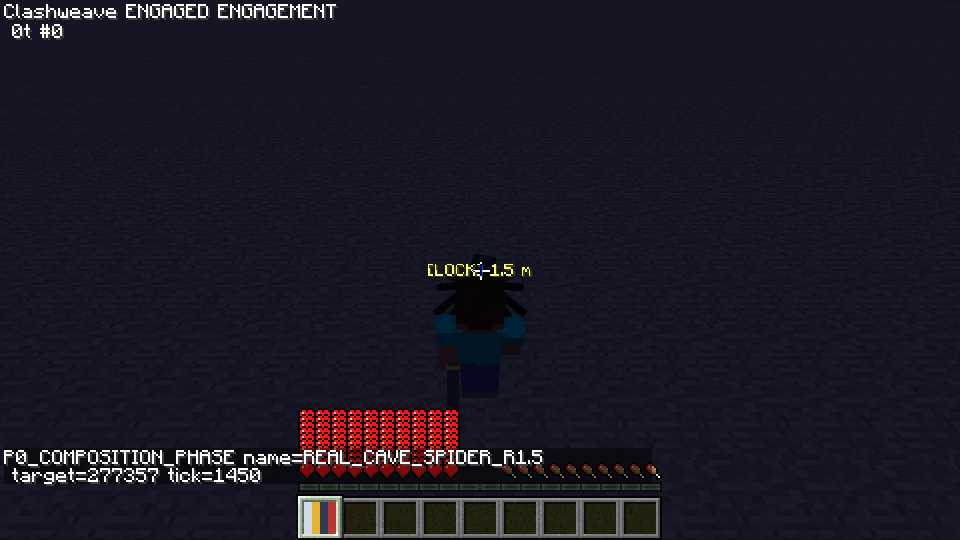
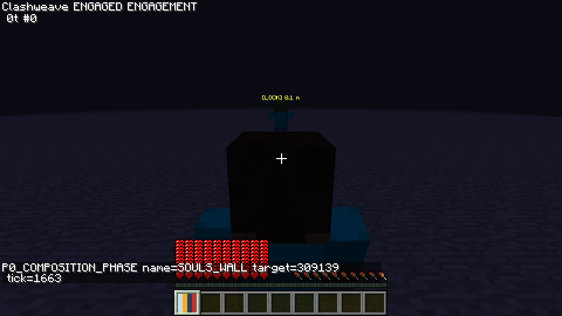
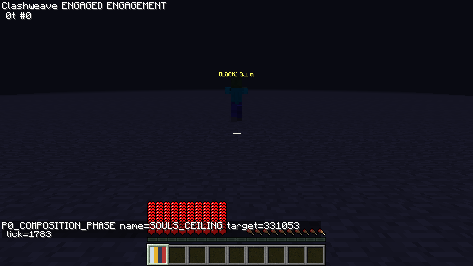
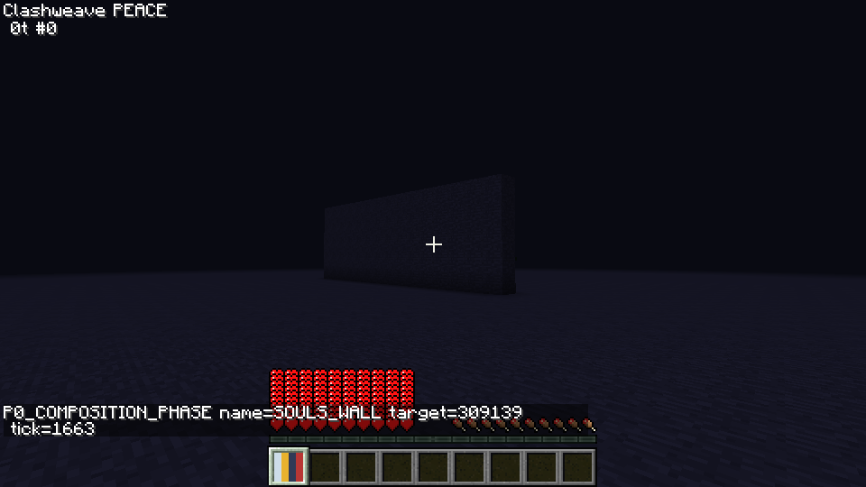
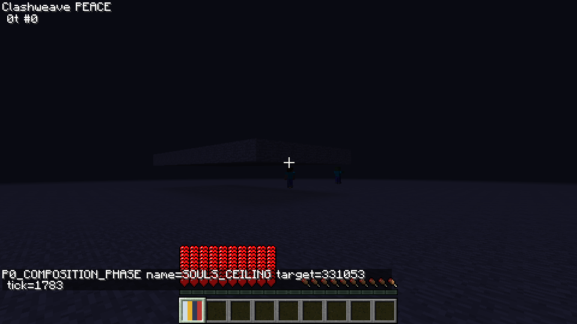
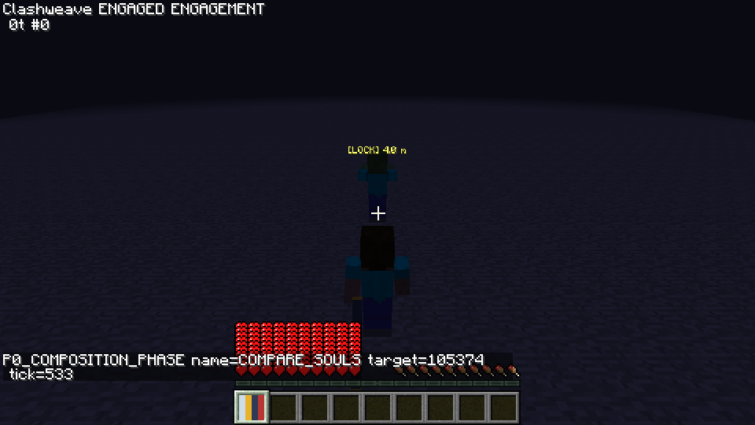
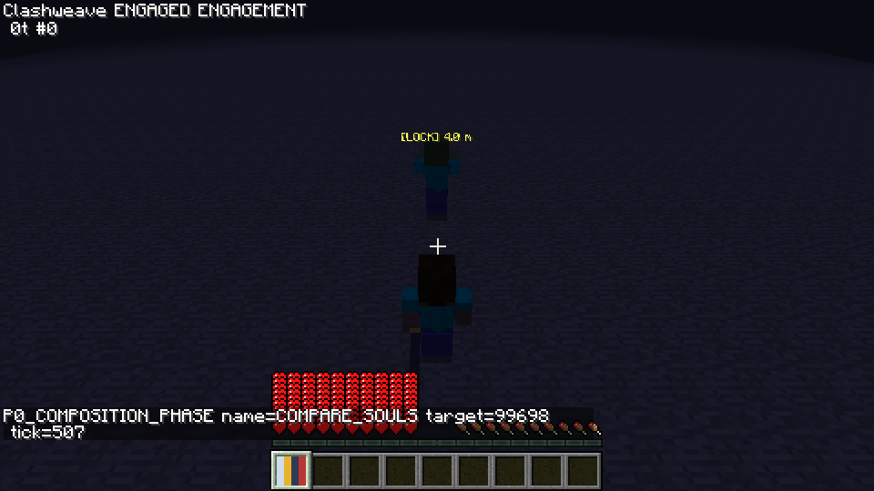
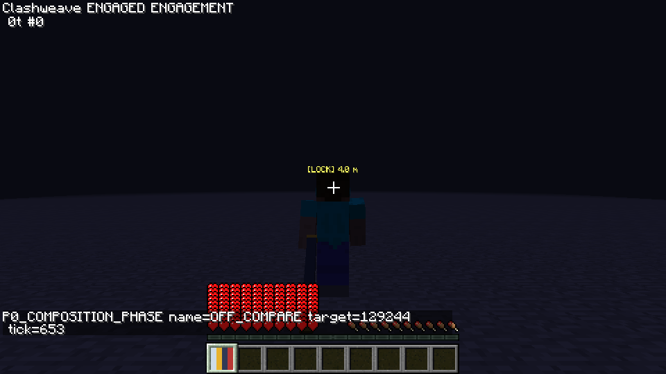

# SOULS 硬边界、小目标与运动构图

## 结论与范围

本轮在 PR #12 同一 prototype/p0-vertical 分支继续。fetch origin/work 确认最新 work=4b85c25，已在分支历史内。只修改相机求解、客户端镜头跟随、camera 配置及相机测试/证据；CombatServer、输入映射、网络消息/协议、动作数据、防御、格挡、交锋、位移预算、朝向历史匹配、攻击辅助、扫掠和特效路径均未修改。

**真实洞穴蜘蛛在1.5格处失败：上缘点与躯干中心的保守包围盒覆盖率均100%。机位为45°、3.5格，没有突破硬边界，也没有在开阔场地隐藏玩家。此项等待用户决定下一步。** 小鸡、蜘蛛在1.5格处躯干被挡，但上缘点无遮挡，按补充标准允许如实保留躯干遮挡。运动指标和完整回归见下表，不能将单元测试通过当作全部构图通过。

3712f43 的58.6°来自同时拟合目标0.38H与玩家0.65H，**不是遮挡本身必然要求的角度**。旧报告保留历史实测；本轮按最新用户决定替换求解目标和取舍，未更改模块的“原稿细节保留”。没有魂类游戏的精确数据；以下全部是用户指定或实测调整的经验起点，不声称来自魂类参考值，也不由数值通过推出主观舒适。

## 参数与求解

| 配置 | 本轮实际默认 | 含义 |
| --- | --- | --- |
| cameraDistance / baselinePitchDown | 4.3格 / 15° | 阻尼初始机位；最终姿态由硬边界与软锚点决定 |
| cameraDistanceMin / cameraDistanceMax | 3.5 / 5.0格 | 轨道距离硬边界，只有碰撞可以收缩到下限以内 |
| cameraPitchMin / cameraPitchMax | 8° / 35° | 大型目标向下俯视边界 |
| cameraHeadClearance | 0.15格 | 相机到选定目标点的射线越过玩家头顶的期望余量 |
| targetScreenY / playerScreenY | 0.45H / 0.68H | 软偏好，自屏幕顶部计；不保证精确拟合 |
| cameraHeightOffset / lateralOffset | +0.6格 / 0 | 沿用居中抬高枢轴，无越肩/新预设 |
| smallTargetHeight / largeTargetHeight | 0.8 / 1.5格 | 使用目标包围盒高，控制线性插值区间 |
| smallTargetPitchMax / smallTargetAimFraction | 45° / 0.85 | 小目标俯视上限与判定点；大型目标用35°与躯干中心0.5 |
| lockStrongSmoothTime / lockTargetFilterTau | 0.15s / 0.1s | 沿用临界阻尼与目标位置指数低通 |
| lockStrongThirdMaxOffset / OffsetDecay | 12° / 240°/s | 本轮调整自由偏移起点，回中速度不变 |
| cameraFeedForwardMaxSpeed | 180°/s | 目标方位角速度前馈限幅 |
| cameraFeedForwardTeleportDistance | 3格 | 对已观测速度预测的**位置残差**门槛，区别普通批量位置样本与跳变 |
| cameraCollisionMaxSpeed | 1.2比例/s | 实测发现顶棚展开偏快后增加该配置；原值4比例/s。物理安全夹值仍优先 |
| collision radius / padding / lookAhead | 0.12 / 0.3 / 0.6格 | 沿用中心、八角及周围原点射线，涵盖抬高后的顶棚 |
| cameraHidePlayerDistance / Hysteresis | 1.0 / 0.2格 | 仅在碰撞收缩后实际轨道距离低于阈值时隐藏本地模型，保留迟滞 |

配置仍在 config/clashweave/combat.cfg 的camera分类，附说明；生产预设仍只有OFF/SOULS。旧cameraPitchAdjustment、cameraDistanceAdjustment不再初始化或参与计算；已有配置文件的未知旧键可能仍被Forge保存，但不生效。已有用户显式写入的其它数值不会被强行重置，本轮各隔离运行均使用新默认。

求解在41个距离样本×61个俯视样本上做确定性搜索。先比较头顶余量的缺口（零缺口优先，无法清空时取最小缺口），再比较两个screenY软锚点的平方误差。射线在玩家前缘0.3格处检查头顶高度，采用站立玩家0.6格宽的保守截面。网格是近似最优，不是连续空间的全局最优证明。目标尺寸插值为：

```text
blend = clamp((bboxHeight - smallHeight) / (largeHeight - smallHeight), 0, 1)
pitchMax = lerp(smallTargetPitchMax, cameraPitchMax, blend)
aimFraction = lerp(smallTargetAimFraction, 0.5, blend)
```

插值后的目标机位经原有阻尼处理，目标切换不重设滤波器/阻尼机位；仅丢弃旧目标速度估计。硬上限仍逐帧执行：从小目标切到大型目标时，如果当前俯视超过新上限，会立即夹到35°。这可能产生角度折点，是“任何帧不越硬边界”的取舍，未声称切换主观完全无突变。轨道距离始终夹在3.5–5.0后再做碰撞收缩；隐藏使用distance×fraction，不再使用包含抬高偏移的眼点到相机向量长度。

垂直FOV每次由当前GL_PROJECTION_MATRIX读取 `2*atan(1/m[5])`，而不是gameSettings.fovSetting。1.7.10 EntityRenderer先计算动态FOV并gluPerspective，再调用orientCamera；原有尾部矩阵接入点可以读取该帧投影。射线碰撞与OFF/第一人称的原版相机分支保留。药水FOV未单独实测，疾跑实测见下文。

## 运动前馈与时钟

对既有低通位置相对玩家的方位角做环绕安全差分，角速度低通后限幅，给阻尼目标加入约 `velocity*(smoothTime+targetFilterTau)` 的前馈，位移前馈角另限45°。恒定速度下用于抵消0.15s阻尼和0.1s位置滤波的相位滞后，不改变服务器动作承诺方向。鼠标、甩动切换、身体朝向逻辑保留；第一人称不进入该分支。

跳变判断比较原始位置与最近观测速度的外推残差；没有足够历史或残差过大时清除前馈，并暂时停止预测，让既有阻尼追踪。位置样本年龄用真实单调墙钟时间，**不是**50ms积分信用；阻尼、位置滤波与转速上限仍以最多50ms的积分dt执行。否则200ms卡顿会把正常位移当成瞬移。纯测试覆盖恒速、批量样本、200ms渲染停顿和真正的位置跳变。任意短距离传送与急转加速仅靠位置样本不总能区分；跨模组传送、极低帧率仍未全面验证。

## 实测方法与证据口径

专用服务器与两个真实Minecraft客户端，Java8、Forge1.7.10，960×540；100ms档由FIFO TCP代理双向各延迟50ms。所有运行创建独立目录并冻结jar SHA，见evidence/camera-bounds中的summary.json。原始日志只留本地ignored build/p0/runs；入库仅聚合JSON、原始PNG和有数量上限的关键摘录，没有逐帧JSON或完整进程日志。

测量调用真实GLU.gluProject；玩家包围盒八角投影形成保守屏幕包围矩形，分别检查目标躯干中心和**包围盒上缘**点。运动使用渲染插值后的实体坐标，不用未插值的tick位置替代画面。覆盖率是几何包围盒代理，不是GPU像素遮挡率；锁定文字标记可越过模型，不能作为目标头部可见的证明。静态表使用收到阶段后的2秒收敛期之外的样本，同时JSON保留全部帧的计数与极值。运动验收使用**整个运动阶段的全部有效投影帧**，同时另列2秒后的数据，不挑选最绿子区间。

最新补充要求不缩放僵尸，因此最终原3×3矩阵用真实蜘蛛0.9格、僵尸1.8格、末影人2.9格作为约1/1.8/3格的对应对象，报告实际尺寸。**精确1.0/3.0格的真实实体矩阵未验证**，没有将0.9/2.9偷记成1.0/3.0。补充矩阵则逐项使用真实小鸡、蜘蛛、洞穴蜘蛛、僵尸和第二客户端EntityPlayerMP，距离1.5/2.5/4/8格。静态夹具关闭玩家受怪物攻击的能力并清除旧/新AI目标以隔离运动；它在服务端布置已知锁定ID，不是近距小目标原生中键获取的验收。动作/网络生产代码不受夹具修改。

## 静态投影与小目标矩阵

以下坐标归一化为W/H，自左上角起。每组静态持续约6秒；主表为2秒收敛后均值与覆盖率，括号外不隐藏过渡：另列全部帧的覆盖率。两套静态表都保留对应JSON中的全部帧极值。开阔场地所有帧隐藏率为0，轨道距离最小3.5；大型目标所有帧最大35°，小目标最大45°，未混用。

| 场景 | 实际高 | 躯干Y | 上缘Y | 玩家Y | 俯视° | 轨道格 | 收敛覆盖% 躯干/上缘 | 全帧覆盖% 躯干/上缘 |
| --- | --- | --- | --- | --- | --- | --- | --- | --- |
| R2_H0.9 | 0.9 | 0.4889 | 0.4485 | 0.6549 | 43.57 | 3.500 | 0.0/0.0 | 6.5/3.7 |
| R2_H1.8 | 1.8 | 0.4920 | 0.3934 | 0.6814 | 35.00 | 3.500 | 0.0/0.0 | 0.0/0.0 |
| R2_H2.9 | 2.9 | 0.4488 | 0.2677 | 0.6798 | 32.30 | 3.725 | 0.0/0.0 | 0.0/0.0 |
| R4_H0.9 | 0.9 | 0.4720 | 0.4365 | 0.6803 | 28.16 | 3.988 | 0.0/0.0 | 0.0/0.0 |
| R4_H1.8 | 1.8 | 0.4513 | 0.3759 | 0.6796 | 26.00 | 4.137 | 0.0/0.0 | 0.0/0.0 |
| R4_H2.9 | 2.9 | 0.4505 | 0.3264 | 0.6799 | 19.25 | 4.512 | 0.0/0.0 | 0.0/0.0 |
| R8_H0.9 | 0.9 | 0.4648 | 0.4401 | 0.6801 | 16.89 | 4.625 | 0.0/0.0 | 0.0/0.0 |
| R8_H1.8 | 1.8 | 0.4504 | 0.4000 | 0.6795 | 15.65 | 4.700 | 0.0/0.0 | 0.0/0.0 |
| R8_H2.9 | 2.9 | 0.4490 | 0.3669 | 0.6798 | 12.05 | 4.850 | 0.0/0.0 | 0.0/0.0 |

高度≥1.2且距离≥2.5的已测真实对象全部躯干/上缘覆盖0%，满足≤5%。0.9格蜘蛛属于插值区，其上限约43.57°，不能把该对象按大型35°限制。

| 真实实体/距离 | 包围盒高 | 躯干X,Y | 上缘X,Y | 俯视° | 轨道格 | 收敛覆盖% 躯干/上缘 | 全帧覆盖% 躯干/上缘 |
| --- | --- | --- | --- | --- | --- | --- | --- |
| CHICKEN_R1.5 | 0.7 | 0.500,0.5318 | 0.500,0.5018 | 45.00 | 3.500 | 100.0/0.0 | 100.0/4.5 |
| CHICKEN_R2.5 | 0.7 | 0.500,0.4808 | 0.500,0.4502 | 40.07 | 3.500 | 0.0/0.0 | 0.8/0.0 |
| CHICKEN_R4.0 | 0.7 | 0.500,0.4701 | 0.500,0.4427 | 29.58 | 3.912 | 0.0/0.0 | 0.0/0.0 |
| CHICKEN_R8.0 | 0.7 | 0.500,0.4623 | 0.500,0.4432 | 17.87 | 4.587 | 0.0/0.0 | 0.0/0.0 |
| SPIDER_R1.5 | 0.9 | 0.500,0.5306 | 0.500,0.4899 | 43.57 | 3.500 | 100.0/0.0 | 99.2/4.8 |
| SPIDER_R2.5 | 0.9 | 0.500,0.4795 | 0.500,0.4386 | 38.83 | 3.500 | 0.0/0.0 | 0.8/0.0 |
| SPIDER_R4.0 | 0.9 | 0.500,0.4720 | 0.500,0.4365 | 28.16 | 3.987 | 0.0/0.0 | 0.0/0.0 |
| SPIDER_R8.0 | 0.9 | 0.500,0.4648 | 0.500,0.4401 | 16.89 | 4.625 | 0.0/0.0 | 0.0/0.0 |
| CAVE_SPIDER_R1.5 | 0.5 | 0.500,0.5399 | 0.500,0.5192 | 45.00 | 3.500 | 100.0/100.0 | 99.2/99.2 |
| CAVE_SPIDER_R2.5 | 0.5 | 0.500,0.4745 | 0.500,0.4536 | 42.53 | 3.500 | 0.0/0.0 | 0.8/0.8 |
| CAVE_SPIDER_R4.0 | 0.5 | 0.500,0.4647 | 0.500,0.4453 | 31.43 | 3.762 | 0.0/0.0 | 0.0/0.0 |
| CAVE_SPIDER_R8.0 | 0.5 | 0.500,0.4575 | 0.500,0.4439 | 19.10 | 4.512 | 0.0/0.0 | 0.0/0.0 |
| ZOMBIE_R1.5 | 1.8 | 0.500,0.5288 | 0.500,0.4258 | 35.00 | 3.500 | 0.0/0.0 | 7.0/0.0 |
| ZOMBIE_R2.5 | 1.8 | 0.500,0.4601 | 0.500,0.3656 | 35.00 | 3.500 | 0.0/0.0 | 0.0/0.0 |
| ZOMBIE_R4.0 | 1.8 | 0.500,0.4513 | 0.500,0.3759 | 26.00 | 4.137 | 0.0/0.0 | 0.0/0.0 |
| ZOMBIE_R8.0 | 1.8 | 0.500,0.4504 | 0.500,0.4000 | 15.65 | 4.700 | 0.0/0.0 | 0.0/0.0 |
| PLAYER_R1.5 | 1.8 | 0.500,0.5288 | 0.500,0.4258 | 35.00 | 3.500 | 0.0/0.0 | 2.8/0.0 |
| PLAYER_R2.5 | 1.8 | 0.500,0.4601 | 0.500,0.3656 | 35.00 | 3.500 | 0.0/0.0 | 0.0/0.0 |
| PLAYER_R4.0 | 1.8 | 0.500,0.4513 | 0.500,0.3759 | 26.00 | 4.137 | 0.0/0.0 | 0.0/0.0 |
| PLAYER_R8.0 | 1.8 | 0.500,0.4504 | 0.500,0.4000 | 15.65 | 4.700 | 0.0/0.0 | 0.0/0.0 |

**洞穴蜘蛛1.5格：失败。** 收敛后上缘100%覆盖，远高于5%；全阶段99.2%，同样失败。鸡与蜘蛛1.5格的躯干100%覆盖如实保留，上缘收敛0%、全帧4.5%/4.8%，均在5%内。僵尸1.5格的初始收敛阶段躯干覆盖7%也列出，该距离不属于大型目标≥2.5格的要求。



图中锁定文字显示不能证明目标上缘可见；判定基于实际目标包围盒投影。其余20组原始截图见同一证据目录。

## 实际投影FOV与疾跑

相同静态场景逐组保持真实客户端疾跑状态，不移动布置位置，以单独比较动态FOV。投影测得普通70.0000°、疾跑80.5000°；这不是把配置70当实际FOV。药水和疾跑中实际奔跑轨迹另未验证。

| 场景 | 疾跑FOV° | 俯视° 普通→疾跑 | 轨道格 普通→疾跑 | 躯干Y 普通→疾跑 | 覆盖% 躯干/上缘 |
| --- | --- | --- | --- | --- | --- |
| R2_H0.9 | 80.50 | 43.57 → 41.79 | 3.500 → 3.500 | 0.4889 → 0.4987 | 0.0/0.0 |
| R2_H1.8 | 80.50 | 35.00 → 35.00 | 3.500 → 3.500 | 0.4920 → 0.4934 | 0.0/0.0 |
| R2_H2.9 | 80.50 | 32.30 → 30.95 | 3.725 → 3.500 | 0.4488 → 0.4612 | 0.0/0.0 |
| R4_H0.9 | 80.50 | 28.16 → 28.16 | 3.988 → 3.500 | 0.4720 → 0.4754 | 0.0/0.0 |
| R4_H1.8 | 80.50 | 26.00 → 26.45 | 4.137 → 3.500 | 0.4513 → 0.4538 | 0.0/0.0 |
| R4_H2.9 | 80.50 | 19.25 → 20.15 | 4.512 → 3.612 | 0.4505 → 0.4493 | 0.0/0.0 |
| R8_H0.9 | 80.50 | 16.89 → 17.49 | 4.625 → 3.725 | 0.4648 → 0.4644 | 0.0/0.0 |
| R8_H1.8 | 80.50 | 15.65 → 16.55 | 4.700 → 3.762 | 0.4504 → 0.4493 | 0.0/0.0 |
| R8_H2.9 | 80.50 | 12.05 → 12.50 | 4.850 → 3.950 | 0.4490 → 0.4515 | 0.0/0.0 |

## 运动居中与压力失败

最终受控矩阵每档各一次，同一真实僵尸连续45°/s→90°/s绕行→正常WASD横移；阶段间不重新传送玩家/重生目标，测量窗口不保存PNG。两个阶段角度连续。每阶段约12秒，使用**全部投影帧**，未丢弃开头或选取子窗口。

| RTT ms | 运动 | 帧数 | |X−.5|中位 W | 95分位 W | 方位误差95分位° | ≤.05W |
| --- | --- | --- | --- | --- | --- | --- |
| 0 | MOTION_45 | 708 | 0.003311 | 0.004433 | 1.008 | 通过 |
| 0 | MOTION_90 | 720 | 0.006952 | 0.009291 | 2.118 | 通过 |
| 0 | MOTION_STRAFE | 723 | 0.018346 | 0.019231 | 4.470 | 通过 |
| 100 | MOTION_45 | 717 | 0.003292 | 0.004401 | 1.000 | 通过 |
| 100 | MOTION_90 | 720 | 0.006955 | 0.011580 | 2.625 | 通过 |
| 100 | MOTION_STRAFE | 725 | 0.018438 | 0.019469 | 4.550 | 通过 |

恒速绕行的角度95分位也小于3°。横移的屏幕指标通过，但角度95分位约4.5°，不声称横移角度也小于3°。同一目标的速度变化仍计入全部帧。

下列**压力失败不能被最终受控矩阵覆盖**：早期夹具在每阶段替换目标、重新定位，并在第5秒渲染线程同步保存PNG。真实时间停顿与PNG保存时刻吻合，包含初始化、目标切换、约200ms停顿的复合负载不是单独恒速实验。raw样本年龄被dt上限误缩的代码问题已修复并补测试，但修复后该复合压力依然失败。

| RTT ms | 压力90°/s帧数 | 中位W | 95分位W | ≤.05W |
| --- | --- | --- | --- | --- |
| 0 | 694 | 0.007127 | 0.097627 | 失败 |
| 100 | 710 | 0.006880 | 0.086596 | 失败 |

早期各次失败/修正原因还保留于development-summary.json（包括首次100ms客户端登录超时、无游戏数据的exit=1）。bounds-motion-0的90°/s p95=.089683W、bounds-motion-final-0=.093774W；没有删去失败再挑全绿。最终隔离矩阵证明指定的连续运动条件，不证明截图停顿或快速切换目标时同样达标。

## 碰撞与隐藏回归

墙、顶棚沿用上一轮几何与接近流程。以每帧实际相机中心及半径.12的27点立方体与布置方块检查；同时保留原始截图。收缩与展开一起计算最大单帧比例变化，安全夹值不为平滑而允许穿墙。

| 场景 | 3712最大单帧比例变化 | 本轮最大变化 | 相机立方体穿块/帧 | 收敛隐藏% | 几何覆盖% 躯干/上缘 |
| --- | --- | --- | --- | --- | --- |
| SOULS_WALL | 0.013385 | 0.010088 | 0/357 | 0.0 | 0.0/0.0 |
| SOULS_CEILING | 0.066519 | 0.026886 | 0/361 | 51.0 | 44.4/34.9 |

两项均未劣于上一轮。低顶棚时投影矩形仍会覆盖目标，但极近碰撞机位本地模型隐藏；此时矩形覆盖不是实际可见模型遮挡，不能算开阔场地求解通过。

| 贴墙锁定相机 | 低顶棚锁定相机 |
| --- | --- |
|  |  |

| 第二客户端观察墙 | 第二客户端观察顶棚 |
| --- | --- |
|  |  |

## 同场景新/旧/OFF三联

真实僵尸4格，同一世界位置、玩家姿态、70°FOV。旧3712f43用改动前冻结的旧jar及其原有coremod运行；SHA在bounds-compare-old/summary.json，不用新代码手工仿旧结果。

| 新SOULS | 旧3712f43 SOULS | OFF |
| --- | --- | --- |
|  |  |  |

| 机位 | 俯视° | 轨道格 | 目标躯干Y | 玩家Y | 躯干覆盖% |
| --- | --- | --- | --- | --- | --- |
| 新SOULS | 26.00 | 4.138 | 0.4513 | 0.6796 | 0.0 |
| 旧3712 | 37.60 | 4.200 | 0.3782 | 0.6492 | 0.0 |
| OFF | 26.00 | 4.138 | 0.5561 | 0.6280 | 100.0 |

新图目标居中偏上、玩家中央偏下且无水平移位；旧图目标更高、俯视更大；OFF目标躯干被玩家覆盖。此场景旧角度37.6°，不能用它冒充所有旧场景58.6°。

## 构建与保留行为

Spotless、Checkstyle、build通过；**72项JUnit实际执行，0失败/0错误**（不是NO-SOURCE）。新增硬边界、小尺寸插值、配置上下界、防开阔隐藏、动态FOV、恒速/批量样本/停顿/跳变测试。既有战斗/协议测试保留。build-summary.json含实际XML统计与时间。

| RTT ms | 完整连击 | SOULS覆盖连击 | 动作START | 连击内S08 | 包导致旋转 | 合法执行 | 格挡/双截止违例 |
| --- | --- | --- | --- | --- | --- | --- | --- |
| 0 | 20 | 20 | 61 | 0 | 0 | 61/61 | 0/0 |
| 100 | 20 | 20 | 61 | 0 | 0 | 61/61 | 0/0 |

“包导致旋转=0”不是相机总旋转为0。跟随自身会连续转动：0/100ms动作开始附近自然yaw最大变化.002555°/.002848°，自然pitch2.148994°/3.280191°，没有S08归因；0ms初始化阶段连击之外有1个未标记包引起正常旋转，也单独保留，不隐去。合法序列均无S08与输入门拒绝。

| RTT ms | 第一人称样本 | 起始yaw | 结束yaw | 最大°/tick | 分支计数 |
| --- | --- | --- | --- | --- | --- |
| 0 | 200 | 35.0 | 8.0 | 9.0 | {'WEAK': 188, 'MOUSE': 5, 'COMMITTED': 7} |
| 100 | 201 | 35.0 | 8.0 | 9.0 | {'WEAK': 187, 'MOUSE': 5, 'COMMITTED': 9} |

与3712f43第一人称旧jar对照：两档同为35→8°、9°/tick，鼠标介入与承诺期不叠加跟随。旧样本201/202、WEAK189/189、MOUSE5/4、COMMITTED7/9；调度时点导致计数轻微不同，不称逐帧完全一致。生产第一人称分支未改；新增前馈与SOULS求解只在第三人称SOULS生效。甩动、身体承诺朝向、既有俯仰低通和渲染帧更新代码保留，相关原JUnit通过；真人手感和每种甩动序列本轮未另做实测。

## 复现命令与输出

在根README要求的Java/资源缓存环境下，先构建夹具，再运行。EULA须由使用者接受（本次已获用户明确同意）。每条dual运行创建独立目录，冻结运行jar并启动专服+双客户端；100ms代理FIFO双向各50ms。

```powershell
$env:JAVA_HOME = "C:\Program Files\Zulu\zulu-25"
$env:VERSION = "0.1.0-dev"
.\gradlew.bat spotlessApply spotlessCheck checkstyleMain checkstyleTest build -I tools/p0/validation.gradle p0LaunchFiles --no-configuration-cache --console=plain
# BUILD SUCCESSFUL; tests=72 failures=0 errors=0
$cameraPython = "C:\Users\layue13\AppData\Local\Programs\Python\Python312\python.exe"
```

实际运行参数如下；共同前缀为 `& $cameraPython tools/p0/dual.py --accept-eula`，表格给出追加参数。复现时换用新的label，避免覆盖现有数据。

| label | 追加参数（含label） | 实测输出 |
| --- | --- | --- |
| bounds-static-valid | `--souls --label bounds-static-valid` | server_exit=0; complete=true; client_class_loads=0 |
| bounds-real-controlled | `--camera-suite real --label bounds-real-controlled` | server_exit=0; complete=true; client_class_loads=0 |
| bounds-sprint-final | `--camera-suite sprint --label bounds-sprint-final` | server_exit=0; complete=true; client_class_loads=0 |
| bounds-motion-isolated-0 | `--camera-suite motion --rtt 0 --label bounds-motion-isolated-0` | server_exit=0; complete=true; client_class_loads=0 |
| bounds-motion-isolated-100 | `--camera-suite motion --rtt 100 --label bounds-motion-isolated-100` | server_exit=0; complete=true; client_class_loads=0 |
| bounds-view-final-0 | `--souls-view --rtt 0 --label bounds-view-final-0` | server_exit=0; complete=true; client_class_loads=0 |
| bounds-view-final-100 | `--souls-view --rtt 100 --label bounds-view-final-100` | server_exit=0; complete=true; client_class_loads=0 |
| bounds-first-0 | `--first-only --rtt 0 --label bounds-first-0` | server_exit=0; complete=true; client_class_loads=0 |
| bounds-first-100 | `--first-only --rtt 100 --label bounds-first-100` | server_exit=0; complete=true; client_class_loads=0 |
| bounds-sweep-audit | `--camera-suite audit --label bounds-sweep-audit` | server_exit=0; complete=true; client_class_loads=0 |
| bounds-compare-new | `--camera-suite compare --label bounds-compare-new` | server_exit=0; complete=true; client_class_loads=0 |
| bounds-compare-old | `--camera-suite compare --mod-snapshot build/p0/baseline-3712f43.jar --snapshot-coremod --label bounds-compare-old` | server_exit=0; complete=true; client_class_loads=0 |

旧jar需要先在3712f43的独立checkout按根README构建并保存上述路径；它不入库，不复制旧生产源码进本分支。压力复合夹具的旧版本和完整日志只在本地ignored目录，development-summary保留版本分类/失败值，最终motion夹具不再同步截图。

```powershell
& $cameraPython tools/p0/camera_bounds_metrics.py --label bounds-real-controlled
# bounds-real-controlled 20 phases
& $cameraPython tools/p0/archive_camera_bounds.py --label bounds-real-controlled --screenshots
# Archived bounded camera evidence: bounds-real-controlled
```

所有主验收运行的专服客户端/OpenGL类加载0，退出0、场景COMPLETE。完整渲染日志不入库，仅按场景限量摘录；证据约2.83MiB，汇总中不含逐帧数组。首次失败的bounds-motion-100是例外，exit1/completefalse，无合法实测输出，不用于运动分位数。

## 只读命中与锁定核对

SweepGeometry四层从**攻击者**高度取点，服务器player.posY为脚底：默认玩家高1.8、bottom=0.1、top=0.95、layers=4，起点约为脚上0.18、0.69、1.20、1.71格。刀尖仍按已有承诺pitch倾斜，目标包围盒扩展0.12水平/0.15纵向后做相交。层高不依赖目标身高；本轮没有修改任何扫掠代码。

真实专服平地、目标距1.9格、输入yaw/pitch=0：小鸡20次请求/20次真实成功COMMIT扣血，蜘蛛20/20，普通僵尸对照20/20，均100%。没有观察到小目标命中率下降。此结论仅覆盖本轮平地静止、水平出刀，不推广为所有仰角、奔跑、跳跃的小目标100%命中；洞穴蜘蛛攻击20次未测。脚本先20小鸡再20蜘蛛再20僵尸，逐案关键COMMIT与summary见bounds-sweep-audit，未静默取消递归伤害或改队列。

锁定获取和保持的距离使用原版getDistanceToEntity：实体posX/Y/Z位置点的三维距离（服务端Y通常为脚底），**不扣除包围盒宽度，不用表面距离**；锥形角度另用玩家眼点到目标眼点。蜘蛛更宽不会获得额外获取/保持距离。近距低矮目标还可能因垂直眼点角度超出获取锥而不能自然获取，本轮静态夹具权威指定ID以单独检验相机，不把该结果冒充锁定选择通过。

## 未解决与下一步

洞穴蜘蛛1.5格的上缘覆盖未满足≤5%。当前选择是保持45°/3.5格硬边界并如实交付，不额外抬高相机、放宽边界或在开阔场地隐藏玩家。请用户审核决定下一轮取舍。主观舒适、再次真人试玩、其它相机/Netty模组共存、药水动态FOV与极低帧率未验证。OFF仍只关闭SOULS机位，不关闭已有第三人称STRONG跟随；要停用跟随使用已有lockFollowThirdPerson=OFF。完成后停止，不开始任何后续战斗内容。
