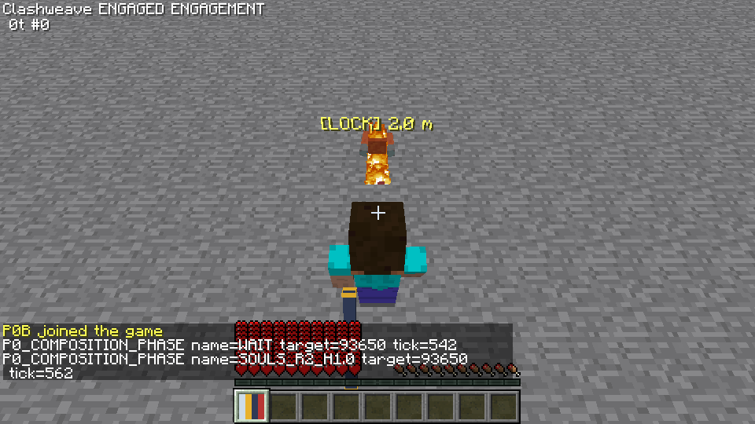
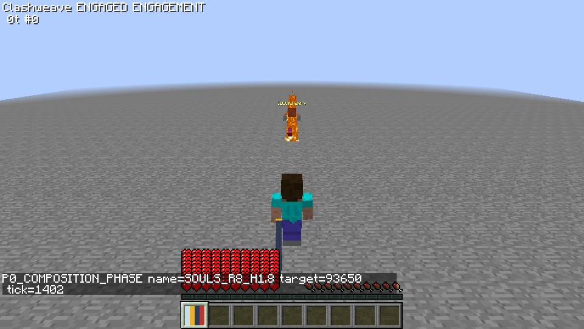
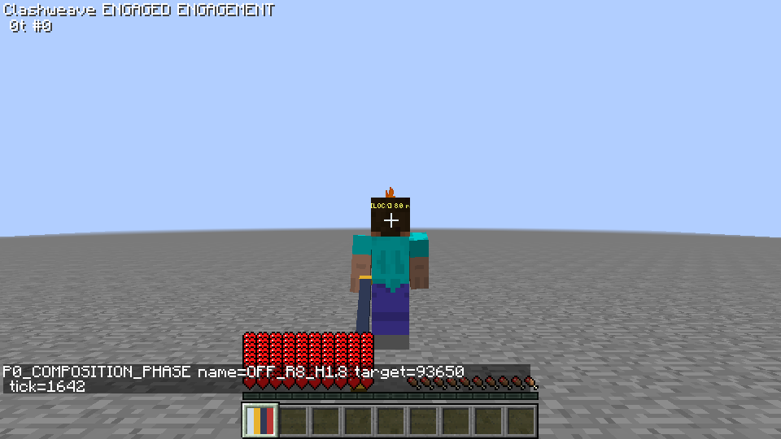
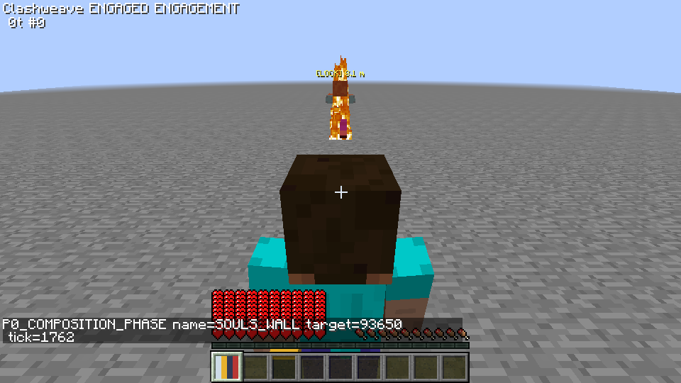
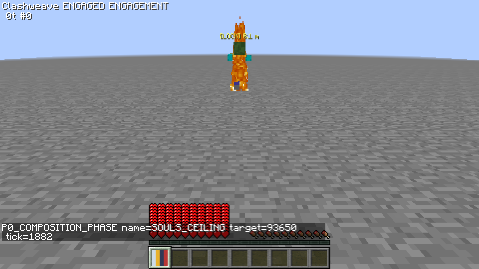
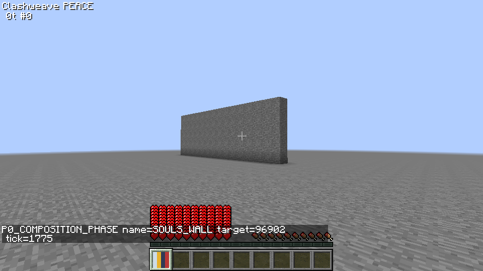
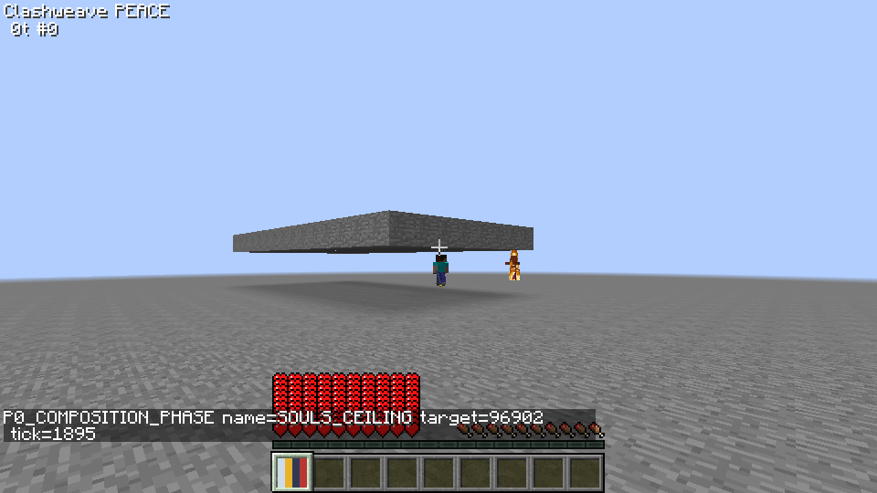

# SOULS 第三人称锁定构图

> 本报告为3712f43历史结果。其58.6°是两屏幕锚点同时拟合的结果，并非遮挡必然要求。最新硬边界、小目标插值与运动结论见[后续报告](SOULS-BOUNDS-MOTION.md)；历史参数不作为当前默认或验收。

## 结论与范围

本轮替换生产构图选项为 OFF / SOULS（默认），不再提供 GOLDEN、THIRDS、CENTER。原先三预设报告和独立越肩探针保留为历史证据；没有把横移探针代码并入生产。独立探针仅为删除旧生产枚举后的编译兼容改用自身legacy参数，仍单独编译/加载，不进入生产jar。新实现是居中、抬高、可碰撞缩短的后方相机。实际参数均为**经验起点，待试玩调整**，不是从魂类游戏采集的参考值，也不能由投影通过证明舒适。

在 prototype/p0-vertical 上继续；fetch、merge origin/work 返回 Already up to date，work=4b85c25，无 rebase。按用户明确反馈替代上一轮暂定黄金构图，不改模块中的“原稿细节保留”。未修改 CombatServer、动作数据、命中、防御、玩家格挡延后、交锋同步、预算、朝向历史匹配、攻击辅助、输入映射或网络消息。

初版严格保持小幅俯视时，2格、1格高目标的躯干仍被玩家遮挡，低顶棚机位进入本地模型。用户随后明确授权“允许更陡俯视与极近机位隐藏模型”。最终近距俯视约58.6°，极近机位只隐藏本地玩家的渲染；服务器和观察者仍正常显示玩家。没有把这些取舍默认为最初的小幅俯视标准已通过。

## 配置与实际调整

配置在 config/clashweave/combat.cfg 的 camera 分类；每项附有含义注释，旧构图名读入后迁移 SOULS。OFF 只停用新机位，仍保留已有第三人称 STRONG 跟随、甩动和身体朝向；要完全关闭锁敌跟随，用已有 lockFollowThirdPerson=OFF。第一人称默认 WEAK 的路径和配置不变。

| 配置 | 用户给出的经验起点 | 本次最终默认 / 边界与含义 |
| --- | --- | --- |
| lockCompositionPreset | SOULS | OFF / SOULS；没有其它生产选项 |
| cameraDistance | 4.2格 | 4.2，1–10；抬高枢轴到后方机位的轨道距离 |
| cameraHeightOffset | +0.6格 | +0.6，0–3；枢轴相对眼点抬高 |
| baselinePitchDown | 10° | **18°**，−30–60；向下为正，作为阻尼初值及自适应区间中心 |
| lateralOffset | 0 | 0，−2–2；保留要求的参数，本轮所有测量为0，没有新增越肩模式 |
| targetScreenY | 0.38H | 0.38，0.1–0.9；目标躯干中心的期望位置，自顶部计 |
| playerScreenY | 0.65H | 0.65，0.1–0.9；玩家包围盒中心的期望位置 |
| cameraDistanceAdjustment | 新增 | ±2.0格，0–3；本次实际轨道距离2.2–5.4格 |
| cameraPitchAdjustment | 新增 | ±42°，0–60；默认18±42，实际解20.8–58.6° |
| cameraCollisionRadius | 新增 | 0.12格，0.05–0.4；中心及八角射线的相机包络 |
| cameraCollisionPadding | 新增 | 0.3格，0–1；提前收缩的距离余量 |
| cameraCollisionLookAhead | 新增 | 0.6格，0–2；玩家周围四个水平原点的提前碰撞检测 |
| cameraHidePlayerDistance | 新增，用户授权 | 1.0格，0–2；相机距眼点小于阈值只隐藏本地模型，0关闭 |
| cameraHidePlayerHysteresis | 新增 | 0.2格，0–1；退出隐藏需要多离开这一距离，防止闪烁 |

从10°/±12°调整为18°/±12°后，2格高1.8/3.0目标已经露出，但2格高1.0仍被覆盖。授权后扩大可用俯视范围；要同时接近期望的两个纵向锚点，2格短目标还需要轨道缩到2.2格。这个近距方案比原始“略远、小幅俯视”更激进，**距离最大调整2格也是需本次审核与试玩的取舍**；不是暗称固定4.2格即可满足所有场景。

旧 lockStrongThirdPitchInfluence、lockCompositionHorizonTolerance 数值项保留以免删配置；SOULS 不再用黄金地平线公式，也不使用这两项决定构图。lockStrongSmoothTime=0.15s、lockTargetFilterTau=0.1s、速度上限、甩动和鼠标小幅偏移沿用上一轮。

## 几何、平滑与源码依据

只在本地玩家、有效锁定、后方第三人称（F5值1）、STRONG、非GUI/睡眠/调试相机时启用。第一人称、前方F5、OFF和无锁定保持原版机位矩阵；前方F5本轮未另加真实运行截图，不以条件分支检查冒充实测。纯函数 SoulsComposition 按目标水平距离与包围盒中心高度，对有界距离/俯视角做确定性最小二乘选择：

```text
A = 抬高枢轴高度 − 被投影点高度
Z = D + r cos(p) + A sin(p)
screenY = 0.5 + (A cos(p) − r sin(p)) / (2 tan(vFOV/2) Z)
误差 = (targetY − 配置targetScreenY)² + (playerY − 配置playerScreenY)²
```

这只是选机位的模型，验收数据使用实际 OpenGL modelview / projection / viewport 的 GLU.gluProject，未以公式计算替代实测。每渲染帧读当前FOV设置；距离、机位pitch与收缩比例均用既有临界阻尼 Spring，真实dt上限50ms；目标位置先沿用指数低通。切目标时保持当前机位数值，只更新阻尼目标，不重置到默认机位；初次联调发现这个重置会造成约7°多余跳变，因此修复后另以continuous档重跑，不覆盖之前的approved档。机位pitch只改变渲染矩阵，不写真实玩家pitch；删除黄金公式后，第三人称STRONG真实pitch采用旧OFF的目标高度追踪基础，构图俯视由独立机位承担。已有跟随仍正常写客户端rotation并发送C03，动作身体仍用承诺朝向。第三人称画面中心准星不等于新机位俯视角下的攻击仰角：攻击仍使用经过既有历史匹配的真实玩家快照，不能把镜头58°当成服务端刀轨58°；这一表现与实际攻击角的关系也需真人评估。保持0横移，目标/玩家的横向投影接近0.5W。

核对本地反编译 EntityRenderer.java 第552–649行：orientCamera 是 private，原版只对原后方机位做八射线；最后眼点补偿 yOffset−1.62，不能直接把本地 getEyeHeight() 当通常的1.62。源码SHA及位置见 [本轮源码核对](evidence/souls-source-audit.json)。Forge 1.7.10 无 CameraSetup。本轮新写小范围 ASM entry/exit hook：先让原版运行，SOULS有效时替换其机位矩阵；OFF不替换。匹配 MCP/SRG 名字，要求1个方法/1个RETURN，布局变化明确报错；Mixin仍关闭。加载器/转换器没有专服客户端类引用。另模组改变相机矩阵或方法布局的兼容性**未验证**。

碰撞对眼点到完整新机位（包含抬高）做中心+八角射线，再用四个周边原点各九射线提前发现墙/顶棚。提前收缩目标经阻尼变化，当前射线的实际安全上限作为最后硬约束。通常步行接近墙/顶棚可提前平滑缩短；**突然在机位上放方块、瞬移进障碍等情形可能必须立即夹值以避免穿墙，不能同时保证绝不跳变**，这些极端场景未实测。不会把这个安全优先例外宣称为完全平滑。

## 命令与构建

```powershell
$env:JAVA_HOME='C:\Program Files\Zulu\zulu-25'
$env:VERSION='0.1.0-dev'
.\gradlew.bat spotlessApply spotlessCheck checkstyleMain checkstyleTest build `
  -I tools/p0/validation.gradle p0LaunchFiles --no-configuration-cache --console=plain
python tools/p0/dual.py --accept-eula --label souls-static-matrix --souls
python tools/p0/souls_metrics.py --label souls-static-matrix
# 最终0/100ms均各运行一次，不挑选绿数据替代失败档
python tools/p0/dual.py --accept-eula --label souls-continuous-follow-zero --composition
python tools/p0/dual.py --accept-eula --label souls-continuous-follow100 --composition --rtt 100
python tools/p0/dual.py --accept-eula --label souls-active-view-zero --souls-view
python tools/p0/dual.py --accept-eula --label souls-active-view100 --souls-view --rtt 100
python tools/p0/dual.py --accept-eula --label souls-approved-first-zero --first-only
python tools/p0/dual.py --accept-eula --label souls-approved-first100 --first-only --rtt 100
# 对各档分别运行 composition_metrics.py、playfix_metrics.py、analyze.py
```

构建实际输出 BUILD SUCCESSFUL；64项JUnit实际执行，失败/错误/跳过均0，含原47项。上一轮三项黄金构图测试被新SOULS几何/枚举测试取代，其余测试保留；新增真实Forge配置默认/覆盖/迁移/非有限值、投影遮挡、碰撞上限、隐藏迟滞及MCP/SRG hook布局测试。测试并未等同于相机兼容性或真人舒适性验收。

## 投影矩阵与截图

场景为专用服务器、两个真实Forge客户端，960×540、FOV70、固定平地；目标是夹具缩放的真实僵尸，服务器/客户端包围盒和渲染同比例缩放到1.0/1.8/3.0格，不是正式美术。目标躯干点取50%高度，头部点90%；八个玩家包围盒角点投影形成保守屏幕矩形，检查点覆盖，**不是GPU像素遮挡率或头部骨骼检测**。僵尸日间燃烧的火焰不计入包围盒。static夹具仅清空测量目标AI任务以隔离受击特效；另有原始可攻击目标矩阵保留真实交锋效果。最终static矩阵9组目标Y的实测范围整体约0.3769–0.3937H；不能推广到任意战斗受击或碰撞机位。每阶段6秒，表为到达阶段消息后2秒以上的实际帧均值；阶段全部帧另存JSON，未删除过渡数据。

| 距离/高度（格） | 帧数（2秒后） | 目标中心Y/H | 目标头部Y/H | 玩家中心Y/H | X/W（目标/玩家） | 轨道距离/俯视 | 头部/躯干框覆盖 |
| --- | --- | --- | --- | --- | --- | --- | --- |
| R2_H1.0 | 231 | 0.3771 | 0.3334 | 0.6476 | 0.500/0.500 | 2.20格 / 58.60° | 0%/0% |
| R2_H1.8 | 236 | 0.3848 | 0.2992 | 0.6511 | 0.501/0.500 | 2.71格 / 52.91° | 0%/0% |
| R2_H3.0 | 236 | 0.3833 | 0.2294 | 0.6514 | 0.501/0.500 | 3.52格 / 44.48° | 0%/0% |
| R4_H1.0 | 234 | 0.3769 | 0.3452 | 0.6470 | 0.500/0.500 | 3.90格 / 41.80° | 0%/0% |
| R4_H1.8 | 235 | 0.3787 | 0.3192 | 0.6495 | 0.500/0.500 | 4.20格 / 37.49° | 0%/0% |
| R4_H3.0 | 236 | 0.3811 | 0.2787 | 0.6508 | 0.501/0.500 | 4.71格 / 30.60° | 0%/0% |
| R8_H1.0 | 219 | 0.3775 | 0.3558 | 0.6485 | 0.500/0.500 | 5.00格 / 27.80° | 0%/0% |
| R8_H1.8 | 237 | 0.3792 | 0.3393 | 0.6507 | 0.500/0.500 | 5.11格 / 25.00° | 0%/0% |
| R8_H3.0 | 236 | 0.3821 | 0.3151 | 0.6501 | 0.500/0.500 | 5.40格 / 20.80° | 0%/0% |

[最终static逐阶段数据](evidence/souls-static-matrix/souls-metrics.json)及[实际配置](evidence/souls-static-matrix/camera-config.json)保存均值、极值、帧数、遮挡和碰撞。







SOULS/OFF对比保持同玩家、同目标、同位置与FOV；OFF不使用缓存的SOULS距离/pitch诊断值。9组开放场景的模型都仍显示；本次近距隐藏不是用来掩盖开放场景遮挡。

## 墙与低顶棚





墙/顶棚位于镜头后上方，owner画面本身不完整展示障碍结构，需结合夹具坐标和实际机位日志检查；补充观察者侧面场景截图另列，仅用于展示障碍布置，不能当成SOULS机位效果。




夹具墙x=−7..7、y=64..68、z=−3；顶棚x=−7..7、y=66、z=−9..−2。玩家从z4向z0每tick0.04格接近，目标保持身前8格。夹具用服务器传送推进位置，其S08不属于合法连击视角回归，单独统计，不混充战斗纠正。逐阶段S08数量与旋转变化保留在[夹具传送统计](evidence/souls-static-matrix/fixture-position-packets.json)。

| 碰撞场景 | 全部机位帧 | 相机包络/中心进块 | 收缩比例最小值 | 比例单帧最大变化：全部/2秒后 | 隐藏帧占比（2秒后） | 原始框遮挡：头/躯干 | 实际渲染遮挡：头/躯干 |
| --- | --- | --- | --- | --- | --- | --- | --- |
| SOULS_WALL | 348 | 0/0 | 0.2185 | 0.0134/0.0134 | 0.00% | 0.00%/0.00% | 0%/0% |
| SOULS_CEILING | 357 | 0/0 | 0.0384 | 0.0665/0.0433 | 46.41% | 29.96%/33.33% | 0%/0% |

两个碰撞场景全部帧的收缩比例速度超过4/s次数均0；本次步行接近未触发超出该上限的安全跳变。中心进入实心块次数和0.12格相机立方包络在已放置墙/顶棚中的交叉次数均按全部实际机位帧计算，不能推广到未测试的任意复杂碰撞盒。碰撞时原始包围框可能覆盖目标；有效渲染遮挡另扣除本地隐藏帧，两者都保留。强收缩后目标/玩家不再保持0.38/0.65构图，安全和目标可见优先。

## 保留行为回归

[0ms每帧跟随](evidence/souls-continuous-follow-zero/composition-metrics.json)、[100ms每帧跟随](evidence/souls-continuous-follow100/composition-metrics.json)、[0ms实际SOULS连击](evidence/souls-active-view-zero/view-metrics.json)、[100ms实际SOULS连击](evidence/souls-active-view100/view-metrics.json)、[构建XML](evidence/souls-build/summary.json)。


| 回归项 | 0ms | 100ms |
| --- | --- | --- |
| 实际完成连击 / SOULS覆盖序列 / START | 20/20/61 | 20/20/61 |
| 合法连击内S08 / 包引起视角变化 | 0/0 | 0/0 |
| START跨tick最大yaw/pitch变化（自然跟随，不是S08） | 0.006744° / 1.111767° | 0.008970° / 2.722582° |
| 合法输入执行 / 格挡不变量 / 双截止违例 | 61/61 / 0 / 0 | 61/61 / 0 / 0 |
| 绕身yaw峰值（上限720°/s） | 33.761°/s | 32.903°/s |
| 高频抖动yaw幅度比 | 0.53146 | 0.44529 |
| 上下跳动时实际机位pitch峰峰值 / 峰值速度 | 10.172° / 37.880°/s | 13.688° / 44.115°/s |
| 甩动小幅/静止测试 / 误触 | 20+20 / 0 | 20+20 / 0 |
| 第一人称WEAK：yaw收敛 / 最大步进 / 鼠标、承诺让出写入 | 35→8° / 9° / 0、0 | 35→8° / 9° / 0、0 |
| JUnit / 专服客户端、OpenGL类加载 | 64，失败/错误/跳过0 / 0 | 64，失败/错误/跳过0 / 0 |

原 LockFollow、输入/协议、服务端战斗逻辑和 KatanaPlayerRenderer 文件未改；第一人称默认WEAK独立回放不经过前面甩动换目标的阶段，避免把更换后的目标方向误当第一人称回归。过去 b54dfe7 runtime 实际结果作为基线，不用后继代码重新生成“旧结果”。本轮取代的只是构图 pitch，不取消每帧yaw阻尼、目标低通、鼠标甩动或动作承诺身体方向。可选第一人称STRONG本轮没有新增运行矩阵，其实现未改、既有JUnit仍通过；不宣称所有物理鼠标或可选组合都已试玩。

合法连击的包指标按实际收到S08及包处理前后旋转统计；连续STRONG本身的平滑转动不是“包导致旋转”。旧approved档登录阶段各有1条未标记S08把初始yaw转180°，发生在连击开始之前，按原版处理；没有删掉这些记录。最终active档另列全部包变化，不能将登录包混充连击纠正。action START采样差和全部包记录另存，不能仅看两个tick间的角差推断包回拉。0/100ms各20条序列，详见视角JSON及逐命中双截止分析。最终active档还要求souls_covered_sequences=20，每条有实际相机帧，而非只看第三人称配置开关。正常STRONG继续旋转会使START采样差不为0；这些真实数值也列入表中，不能把“无包回拉”夸大成“镜头完全不动”。

## 过程失败与限制

最终100ms档启动时，定义确认（kind=−2）仍有既有STALE/RATE拒绝：{'STALE': 30, 'RATE': 6}。这些不是合法攻击请求；实际61条合法动作全部执行，但初始化同步的这项已知现象未被相机修改解决。保留逐请求记录，没有把它们删出原日志。

逐条检查还发现早先souls-approved-view档的20条连击中SOULS实际帧覆盖为0，锁定/机位在序列结束后才可用于渲染；这些档只证明旧视角包回归，**不能证明SOULS已启用时的回归**。保留[夹具覆盖缺口](evidence/souls-view-fixture-gap)，随后修正目标出生坐标、等待实际机位启用并统计每条覆盖帧，再跑active档。不是重跑挑一次绿覆盖原数据。

第一份授权后矩阵 souls-approved-matrix 中，2格/3格高的僵尸能够打到玩家，保留原版受击倾斜使该组目标Y实际范围0.337–0.442H，而不是稳态均值始终0.405H；截图中的倾斜与玩家燃烧不是新相机的横移。为测清纯几何，随后仅在SOULS测量夹具把目标攻击属性设0，另跑controlled矩阵，但原版零伤害仍能带来受击/燃烧等副作用，不能把它当真正无扰动。最终static矩阵在出生前清空该测量僵尸的AI任务，保留正常形状/实体追踪，才隔离静态几何。生产怪物伤害与AI没有改，没有取消生产伤害或递归回调。approved与controlled旧矩阵及图仍保留，受击特效是否符合真人构图感受仍待试玩。

初次试验有两类夹具/实现错误：本地posY眼点基准使用错误；僵尸setSize被自身缩放缓存覆盖。两次数据无效，未作验收数字。修正后10°起点和18°小幅方案的真实失败不作废：短目标仍被覆盖。第一次碰撞实现还误用了会被World.rayTraceBlocks修改的start Vec3，导致缩到0；修正为用独立保存的起点坐标计算距离。

只有当前射线而无周边提前检测时，低顶棚的收缩比例单帧最大变化约0.459；加0.6格周边检测后约0.043，但出现本地模型挡满画面。保留调整前摘要、关键片段与两张失败截图，见 [授权前限制](evidence/souls-before-approval)。用户授权后才增加较陡俯视和极近机位隐藏；最终结果不覆盖这些失败记录。

待审核/未验证：真人舒适性；近距2.2格/58.6°是否过陡；其它相机coremod与后处理共存；正式启动器下重映射发布jar的运行（当前真实运行使用MCP开发jar，SRG注入单元测试已过）；动态FOV（疾跑/药水/受击）与anaglyph；云雾判定仍沿用原版眼点；不同帧率硬件矩阵；突然放块/瞬移碰撞的跳变；非完整方块的复杂碰撞以及极近机位整片near-plane裁剪。FOV设置变化会重算，未宣称全部动态视效通过。

完成后停止，等待用户审核与再次试玩，不进入其它战斗/相机功能。
